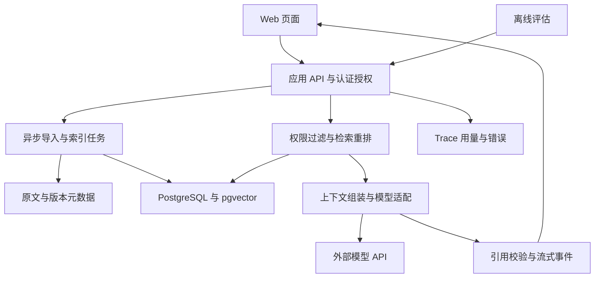

# 三个可落地的 AI 应用实践项目

## 选择建议

知识助手练习检索与证据，运维助手练习工具与状态，工单流程练习结构化与业务集成。

| 项目 | 最适合证明什么 | 完整开源学习样本 | 建议优先级 |
| --- | --- | --- | --- |
| 技术文档知识助手 | RAG、引用、数据生命周期、权限与评估 | WeKnora 或 Dify，RAGFlow 作解析对照 | 第一主项目 |
| 受控运维与故障分析助手 | 工具、执行状态、审批、可恢复任务 | Coze Studio 与 WeKnora | 适合进一步学习工具执行与可靠性 |
| 文档到工单的业务工作流 | 结构化、规则、人工复核与系统集成 | Dify 或 Coze Studio | 偏业务产品或交付岗位时选择 |

实现可选 Python 或 Go；固定版本和部署入口见[开源样本](open-source-samples.md)。以下指标为项目验收目标。

## 项目一 技术文档知识助手

### 用户问题与价值

回答“这个版本的接口有哪些限制”“某个服务如何优雅退出”“某种错误应在哪层处理”。知识源采用版本明确的技术文档，答案关联原文、适用版本与证据位置。

核心功能：带引用回答、版本过滤、文档更新删除、权限隔离。

### 分期范围

| 版本 | 要完成的功能 | 证明方式 |
| --- | --- | --- |
| V0 对照基线 | 原始模型直接回答、关键词查找；建立真实问题集 | 保存相同问题下的原始输出与检索结果 |
| V1 知识问答 | Markdown 导入、向量/关键词检索、引用、流式回答、取消 | 检索和问答分开评估 |
| V2 数据治理 | 重复导入、文档版本、更新删除、索引状态、权限隔离 | 修改和删除后旧结果不再可见 |
| V3 工程交付 | 可观测、预算、回归评估、部署恢复、小规模试用 | 另一位开发者按说明运行 |
| 选修 | PDF/表格解析、只读 MCP 工具、问题澄清 | 额外数据集证明收益，再决定保留 |

第一版暂不加入全网爬虫、复杂多 Agent、自动修改源码和训练专属模型。先把文档质量和检索问题看清楚。

### 建议架构

初始可用一个 Python 或 Go 服务进程和数据库任务表，不急于拆微服务。文档原文可先用本地持久目录；需要多实例再加入对象存储。关键词基线保留标识符精确匹配，中文分词用项目问题集验证。

数据实体至少包括：文档与版本、chunk、索引任务、Embedding 配置、会话、回答证据、评估案例、运行记录。记录模型标识与 Embedding 维度；换 Embedding 时重建对应索引，不能把不同向量空间直接混用。

### 验收与源码学习

使用[阶段 3 的固定数据集和门槛](roadmap.md)：先看检索 Hit@5，再看回答正确与引用支撑；另外测试跨版本、资料缺失和多租户场景。要求失败记录能区分解析遗漏、召回遗漏、上下文丢失和生成误读。

选择 WeKnora 或 Dify 部署后，用同一批 20 份文档与 10 个问题对照。深读一次上传入库和一次问答链路，选一个小改造：按文档版本过滤、索引任务幂等、检索评估导出三选一。不要仅改页面和品牌名称。

**作品展示脚本**：正确回答并打开引用 → 问资料外问题 → 比较两个版本 → 删除文档再问 → 切换租户验证隔离 → 展示一次失败分析和修改前后报告。

## 项目二 受控运维与故障分析助手

### 用户问题与价值

面向后端值班人员，接收“结算服务这十分钟变慢了”之类请求，查询模拟指标、日志与操作手册，生成有证据的排查建议，并在确认后创建模拟故障工单。

这个场景用于练习超时、并发、错误处理、工具权限和系统运行可靠性。第一版使用本地模拟环境，不连接真实生产系统；诊断建议与已证实原因分开。

### 工具与执行边界

| 工具 | 输入与输出重点 | 服务端约束 |
| --- | --- | --- |
| 查询服务状态 | 服务 ID、环境、时间；返回状态与采样时间 | 服务和环境白名单 |
| 查询指标 | 指标名、时间范围；返回结构化序列及缺失标记 | 限定范围、超时、结果大小 |
| 检索日志 | 服务、时间、关键词；返回脱敏记录与游标 | 租户权限、条数限制、脱敏 |
| 查询操作手册 | 问题、服务版本；返回文档片段与来源 | 只读，返回内容不能成为新指令 |
| 创建模拟工单 | 标题、证据、建议、确认记录 | 人确认、身份绑定、幂等键、审计 |

工具参数中的租户、权限和可用资源以认证身份和服务器策略为准；不接受模型自报“管理员”作为凭据。模型生成的操作建议不能直接拼接为 Shell 命令。

### 分期实现

1. **固定流程基线**：查询状态 → 查指标 → 查日志 → 整理证据；不使用自主规划。
2. **Agent 版本**：允许选择只读工具，最多 8 步；每次工具结果进入持久事件，支持取消。
3. **任务恢复**：进程重启后恢复任务；已完成只读结果是否重查由新鲜度规则决定。
4. **写操作闭环**：先生成工单草稿，确认时绑定草稿摘要、目标、用户与有效期；参数变化则重新确认。对工具重复调用和重复确认做业务幂等。
5. **对外连接**：把一个只读工具用 MCP 暴露给兼容客户端，验证协议与授权，而非一次性暴露所有运维功能。

### 任务与验收

构造慢查询、连接池耗尽、下游超时、服务正常、指标缺失、证据冲突等场景。20 条开发、20 条留出；每条留出独立重置场景试 3 次，共 60 次。建议至少 48/60 次业务成功，同时报告每类成功率与三次均成功的任务比例。

最终成功需要证据与场景吻合、未遗漏关键限制、没有未授权操作；创建工单时还要查询数据库确认只有一个正确工单。明确没有证据时不强行断言根因。记录平均工具步数、总时间、每次成功费用以及恢复后的状态。

与 Coze Studio 对照同一条工作流，观察节点、事件和失败表现；再读 WeKnora 的工具与任务入口。框架提供的 checkpoint 不能替代外部副作用的业务幂等设计。

**作品展示脚本**：同一故障的固定流程和 Agent 对比 → 工具超时 → 取消或重启后恢复 → 修改草稿使确认失效 → 重复确认只创建一张工单。

## 项目三 文档到工单的业务工作流

### 用户问题与价值

面向服务支持或内部运营人员，把用户邮件、报障单或附件变成可审核的结构化工单，自动找出缺失字段，按确定性业务规则分派，并保留原文证据。

它适合展示“AI 处理非结构化内容，传统服务负责确定性规则与写入”的协作方式。比自动客服更容易建立明确评分和人工复核闭环。

### 分期实现

| 阶段 | 最小范围 | 验收方法 |
| --- | --- | --- |
| V1 结构化 | 文本输入，抽取分类、服务、时间、紧急程度、缺失字段 | 使用阶段 2 的字段评分，不以 JSON 合法代替准确 |
| V2 业务流程 | 查服务目录、按规则分派、人工修订、创建工单 | 比较最终工单与审批内容，重试不重复 |
| V3 附件解析 | 加入少量 PDF、表格或图片；提供页码或原文片段 | OCR/解析与字段抽取分别评分 |
| V4 交付 | 批量任务、失败队列、审计、脱敏与运行指标 | 固定批次全量状态可追踪 |

采用 Dify 或 Coze Studio 做同一需求的快速平台版，再用 Python 或 Go 实现关键业务服务。附件解析和评估工具按依赖需求选择。先用合成或获准的脱敏资料，不以真实客户数据作为演示素材。

额外验收：对 30 份留出附件人工标注关键字段和证据，报告字段 F1 与需人工修订比例；重复上传 5 次不产生 5 张重复业务工单。时间字段不明时保留未知，不用当前时间自动补齐。建议关键字段 F1 至少 0.90，错派高风险工单的情况单列，不被平均分掩盖。

**作品展示脚本**：正常输入 → 缺失字段 → 表格解析错误 → 人工修改 → 确认后写入 → 重复消息去重 → 查看批次报告。

## 共用的落地与展示材料

| 材料 | 必须能回答的问题 |
| --- | --- |
| 一页场景说明 | 用户现在怎么做？模型提供什么新增价值？ |
| 架构与数据流 | 哪些确定性规则由程序执行？数据流到哪里？ |
| 可重现部署 | 环境、版本、数据、启动、验证、停止、恢复怎么做？ |
| 评估报告 | 用了什么集合、什么分母、怎么评分、和谁比较？ |
| 失败案例 | 哪些仍然做不好？如何检测和限制影响？ |
| 成本与运行报告 | 成功任务花费多少？重试和失败消耗多少？ |
| 个人贡献说明 | 引用了什么开源代码？自己改变了什么？ |

## 预算与范围控制

预算按调用次数、输入输出 Token、Embedding、重排、OCR 和基础资源分别估算，并设置费用上限。预算不足时先缩小数据集和试验次数。

先建立质量较好的模型基线，再测便宜模型是否能达到同一验收标准。Embedding、重排与 OCR 是否需要额外服务单独核算。不要用平台最低运行配置去估算本地大模型的内存和显存，也不要在没有测量收益时先扩充硬件。
