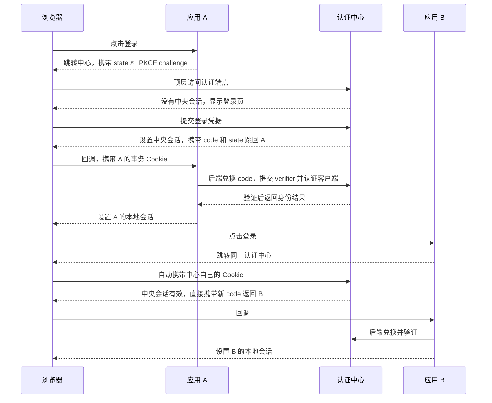

# 什么是单点登录

> 分类：认证与会话｜实验：Python 标准库｜检索日期：2026-11-02

单点登录（SSO）解决的是：用户在一个认证体系内完成一次登录后，访问多个已接入应用时，通常无需再次提交登录凭据。理解这道题的关键是把“认证中心的登录态”和“各应用的登录态”分开。

## 这道题考察什么

| 能力 | 基础回答需要说清 | 深入回答可以展开 |
| --- | --- | --- |
| 概念区分 | 认证确认身份，授权决定可做什么 | SSO、OAuth 2.0、OIDC、JWT 的不同职责 |
| HTTP 与浏览器 | Cookie 如何携带会话标识 | 同源、同站、Cookie 域、顶层重定向的区别 |
| 信任传递 | 应用为什么信任认证中心 | 后端兑换、签名验证、回调绑定与重放防护 |
| 会话设计 | 中央会话与本地会话独立 | 过期、撤销、单点退出、多设备管理 |
| 工程取舍 | 能画出并解释完整流程 | 中心故障、共享存储、一致性与可观测性 |

只说“登录后把 token 存 Redis，其他系统查 Redis”还没有解释浏览器如何访问不同应用，以及每个应用如何安全确认身份。

## 公开问法与出处

以下是个人公开面经，不是公司官方题库；表内问法均为摘要或归纳。日期是帖子显示的发布或编辑日期，不等于面试发生日期。

| 公司及轮次（帖子声称） | 问法归纳 | 原文日期 | 来源与核验情况 |
| --- | --- | --- | --- |
| 淘天，中小企业技术部，二面 | Token 放在 Redis 后，多域名访问时如何识别用户？SSO 的实现和优缺点是什么？ | 2023-09-03，已编辑 | [牛客个人面经](https://www.nowcoder.com/discuss/527872104683884544)，可读到正文对应段落 |
| CVTE，一面 | 单点登录；不使用它时怎样管理 Session；Cookie 与 Session 的区别 | 2019-05-21，已编辑 | [牛客个人面经](https://www.nowcoder.com/discuss/353155051797553152)，可读到正文 |
| 字节跳动，一面 | 项目中的 SSO 如何实现？为什么使用 Redis？ | 2025-08-15 | [牛客个人面经](https://www.nowcoder.com/feed/main/detail/7199d28abd5e4826b645e9d79db8bc39)，搜索摘要可见题目，直开正文仅返回页面壳 |
| 字节低代码，一面及二面 | SSO 的实现、Token 风险、XSS；统一门户中的登录与权限设计 | 2023-03-09，已编辑 | [牛客个人面经](https://www.nowcoder.com/discuss/462675670150213632)，搜索摘要可见，直开正文仅返回页面壳 |

据此可归纳三种问法：**概念题**“什么是 SSO”；**项目题**“你的系统具体怎么做”；**场景题**“跨域、泄露、退出和故障时怎么办”。这只是当前样本呈现的问法，不代表各公司的题目分布。

## 面试时可以这样回答

> 单点登录是让用户在一个认证体系内登录一次后，可以访问多个接入应用，通常不用重复输入凭据。常见做法是引入统一认证中心，各应用保留自己的本地会话。用户访问应用 A 时，如果没有本地会话，就跳转认证中心；认证中心完成登录，发回短期、一次性授权码，应用 A 的后端验证并兑换后建立自己的会话。之后访问应用 B，仍会经过认证中心，但中央会话还有效时，通常可以直接返回，B 再建立自己的会话。跨独立域名不需要共享 Cookie。实际接入可以采用 OIDC 等身份协议，还要考虑回调地址、请求绑定、授权码重放和退出传播。

这段回答中的授权码流程是常见实现方式，SSO 的定义本身不限定一种协议。[NIST 定义](https://csrc.nist.gov/glossary/term/single_sign_on)、[OIDC 授权码流程](https://openid.net/specs/openid-connect-core-1_0.html#CodeFlowAuth)。

## 从园区门禁理解登录态

NIST 将 SSO 描述为使用一套账号及认证器顺畅访问多个应用的认证过程，通常通过联合身份协议实现。[NIST 术语表](https://csrc.nist.gov/glossary/term/single_sign_on)。

可以想象一个园区：接待处核验身份，各栋楼有自己的门禁。你第一次去 A 楼，需要到接待处核验；接待处给 A 楼一张短期证明，A 楼确认后给你自己的通行凭证。去 B 楼时，接待处还记得你已经通过核验，所以不再要求重做一次身份检查，但 B 楼仍要建立自己的通行记录。

比喻的边界是：接待处认识你，不代表你能进入每个机房。SSO 主要减少重复认证，业务权限仍需分别判断；高风险操作也可能要求重新认证或多因素认证。

实际应用包括企业门户接入报销、工单和知识库，以及多个产品共用统一账号体系。这些是应用场景示例，不对应上表公司的内部架构。

## 三种状态和完整流程

| 状态 | 存在哪里 | 浏览器携带什么 | 用途 |
| --- | --- | --- | --- |
| 中央会话 | 认证中心服务端 | 只发给中心的 Cookie | 证明用户此前已在中心登录 |
| 登录事务 | 应用服务端 | 临时事务 Cookie 及回调 state | 把回调和发起登录的浏览器关联起来 |
| 应用会话 | 各应用服务端 | 各自的会话 Cookie | 处理该应用后续请求 |

这张表采用服务端会话方案；其他系统也可能采用签名令牌等设计。



浏览器负责跨站导航，服务端负责兑换与验证。授权码应短期有效、只用一次，并绑定客户端和回调地址；这不是一个可长期复用的登录 Token。[RFC 6749 §4.1](https://www.rfc-editor.org/rfc/rfc6749.html#section-4.1)。

## 衍生追问与回答

以下除已列出的面经问法外，均为老G补充，用于串起知识点。

### 共享 Cookie 就是单点登录吗

同一父域下的应用可以设计共享 Cookie 方案，但要一起承担更大的信任范围。独立域名之间不能靠设置一个任意 `Domain` 来共享 Cookie。SSO 可以通过重定向和可信身份结果实现，不要求跨域共享 Cookie。[MDN Cookie 作用范围](https://developer.mozilla.org/en-US/docs/Web/HTTP/Guides/Cookies#Define_where_cookies_are_sent)。

补充两个区别：不同端口就属于不同源，但 Cookie 不按端口隔离；“同站”又不同于“同源”，例如同一可注册域下的两个 HTTPS 子域通常同站却不同源。CORS 约束脚本跨源读取，不负责建立 SSO 信任关系。实验因此用三个不同回环 IP，避免用同一主机不同端口冒充 Cookie 隔离。[浏览器同源规则](https://developer.mozilla.org/en-US/docs/Web/Security/Same-origin_policy)。

### OAuth 2.0 OIDC JWT 各是什么

OAuth 2.0 是授权框架，解决应用获得受限资源访问权的问题；仅看到 OAuth access token 不能把它当成面向当前客户端的登录身份证明。[RFC 6749](https://www.rfc-editor.org/rfc/rfc6749.html)。

OIDC 在 OAuth 2.0 上增加身份层，提供 ID Token 等机制。客户端需要按规范校验签发者、受众、有效期、签名以及适用的 nonce 等条件，不能只解码载荷就信任。[OIDC Core §2 与 §3.1.3.7](https://openid.net/specs/openid-connect-core-1_0.html#IDTokenValidation)。

JWT 是令牌格式，不是登录协议；SSO 可以不用 JWT。普通签名 JWT 的内容通常可读，签名用于验证完整性，不等于加密；JWT 也可以采用加密形式。[RFC 7519](https://www.rfc-editor.org/rfc/rfc7519.html)。

### state PKCE nonce 分别防什么

| 机制 | 核心用途 | 在本实验中的处理 |
| --- | --- | --- |
| state | 关联登录请求与回调；安全绑定浏览器后可防登录 CSRF | 随机值，同时绑定事务 Cookie 与服务端记录，用后删除 |
| PKCE | 将授权码兑换绑定到持有本次 verifier 的发起方 | 发起时传 S256 challenge，后端兑换时提交 verifier |
| nonce | OIDC 中把 ID Token 绑定到认证请求，客户端验证其一致性 | 未实现，因为实验不签发 ID Token |

PKCE 的 S256 计算是 `BASE64URL(SHA256(verifier))`，去掉末尾填充。截到 code 的人没有 verifier，就不能正常兑换。[RFC 7636](https://www.rfc-editor.org/rfc/rfc7636.html)。

`state` 必须实际校验并绑定发起浏览器，只“生成一个随机值”不够。客户端密钥证明“哪个应用”，不能替代“哪次浏览器登录事务”。安全最佳实践要求防范授权码注入，公共客户端必须使用 PKCE，机密客户端也推荐使用。[RFC 9700 §2.1.1 与 §4.7](https://www.rfc-editor.org/rfc/rfc9700.html)。

### 为什么需要授权码而不是在 URL 里传长期 Token

URL 可能进入历史记录、日志或 Referer。一次性短码缩小泄露后的利用窗口，并允许后端在兑换时验证绑定条件；它也需要保密，不是可以随便记录的内容。回调地址采用精确匹配，拒绝未知地址时不要再重定向到该地址。[RFC 9700 §4.1～§4.3](https://www.rfc-editor.org/rfc/rfc9700.html)。

### 为什么项目里会使用 Redis

这是会话与并发设计的工程选择，不是 SSO 的必需组件。多实例可用共享存储保存中央会话、登录事务、授权码和撤销记录；本实验单进程内存即可。选择 Redis 时要解释 TTL、故障策略、键空间以及原子操作，不能只说“读写快”。

授权码应把读取、校验、删除作为一个原子过程。例如通过 Redis Lua 脚本检查绑定与过期后删除，避免两个实例同时兑换成功。直接 GET 后 DEL 存在竞争；本实验在同一把锁内完成这一步。这里是方案推演，未运行 Redis 实验。

### JWT 能否立刻退出失效

如果资源服务器只离线验证签名及过期时间，删除浏览器里的副本不能撤销已经泄露的 JWT。可以选短有效期配合刷新凭据撤销，或引入 denylist、会话版本、在线检查；每种做法都会改变存储、延迟和撤销时效。JWT 的 `exp` 定义见 [RFC 7519 §4.1.4](https://www.rfc-editor.org/rfc/rfc7519.html#section-4.1.4)，撤销方案是工程取舍。

### 本地退出和全局退出有什么区别

本地退出只结束一个应用会话。中央会话仍有效时，再点登录可能立即免密回来；其他应用的会话也不因此自动结束。删除中央会话，同样不自动删除各应用已经建立的本地会话。

全局退出需要定义传播机制和失效时限。OIDC Back-Channel Logout 通过认证中心到应用后端的通信通知退出；应用验证通知后撤销对应会话。工程上还需处理重复通知、失败重试、应用离线和过期兜底。[OIDC Back-Channel Logout](https://openid.net/specs/openid-connect-backchannel-1_0.html)。本实验只实现本地退出，专门用来观察差异。

### 认证中心挂了会怎样

取决于验证路径。本实验已有本地会话的访问可以继续，新的登录或授权码兑换失败；如果每个请求都依赖中心或同一会话存储，影响范围会更大。设计时区分“能否登录”和“已登录请求能否继续”，按业务约定到期与撤销策略，不能在验证失败时直接放行。

### Cookie HttpOnly 能解决全部安全问题吗

不能。HttpOnly 限制脚本直接读取 Cookie；XSS 仍可能借浏览器发起操作。还要考虑 HTTPS 与 Secure、合理的 SameSite、CSRF 防护、会话轮换、超时与服务端撤销。登录凭据和会话标识不写入普通日志。[OWASP 会话管理指南](https://cheatsheetseries.owasp.org/cheatsheets/Session_Management_Cheat_Sheet.html)。

### 接入 Go 或 Python 的生产项目怎么做

通常选择支持 OIDC 的身份提供方和成熟客户端库。应用注册精确回调地址，使用授权码流程与 PKCE，按库和协议要求验证身份结果，再将稳定身份映射到内部账号。业务权限仍在应用侧执行。不要把下面的教学认证中心直接用于生产。

## 最小实验

启动一个认证中心与两个应用，不依赖第三方包。实现的是自定义身份兑换教学模型，保留核心流程及部分安全绑定，**不具备完整 OIDC 兼容性**。

实验依次观察：A 首次登录需要密码 → B 登录不再要求密码 → A 与 B 的 Cookie 相互独立 → 退出 A 后 B 仍在线 → A 再登录可由中央会话免密恢复。

实验代码作为同目录附件：[sso_demo.py](sso_demo.py)、[test_sso.py](test_sso.py)。

### 环境与启动

Python 3.10+，仅标准库，无需安装依赖。实际验证环境：Windows、Python 3.14.3。三个服务在同一进程内运行，但通过真实 HTTP 通信，后端兑换不直接读取中心的会话表。

在仓库根目录执行：

```powershell
cd E:\agentSpace\omni\backend-interview
python sso_demo.py
```

| 角色 | 地址 | 会话 Cookie |
| --- | --- | --- |
| 认证中心 | http://127.0.0.1:9000/authorize（由应用生成参数） | idp_sid |
| 应用 A | http://127.0.0.2:9001 | app_a_sid |
| 应用 B | http://127.0.0.3:9002 | app_b_sid |

在浏览器打开 [应用 A](http://127.0.0.2:9001)。端口需空闲，服务只绑定回环接口。若系统代理拦截这些地址，把 `127.0.0.1`、`127.0.0.2`、`127.0.0.3` 加入代理绕过列表；不要把它们都替换成同一个主机来规避，因为 Cookie 不按端口隔离。认证中心根路径没有首页，直接访问 `/` 返回 404 属于预期。

停止：在启动终端按 `Ctrl+C`。重启会丢失全部内存状态。

### 手动观察

使用干净的浏览器配置或无痕窗口。打开开发者工具，保留 Network 导航记录，并查看三个主机各自的 Cookie。

1. 进入 A，当前用户为“未登录”，点击“统一登录”。浏览器跳到中心，显示登录页。
2. 输入 `alice` / `demo-pass`。中心设置中央会话，经 A 的 `/callback` 返回 A，用户变为 alice。
3. 点击“访问应用 B”。B 此时仍显示“未登录”，说明 A 的本地会话没有直接共享过去。
4. 在 B 点击“统一登录”。浏览器经过中心直接返回，不再输入密码，B 也显示 alice。
5. 在 A 点击“仅退出本应用”。A 显示“未登录”，B 刷新仍是 alice。
6. A 再点登录，中心会话还在，因此无需密码即可恢复 A。
7. 新开完全隔离的浏览器配置，再从 A 登录，需要再次输入密码。两个普通标签页通常共享 Cookie，不能充当隔离的浏览器。

Network 中能看到浏览器的重定向和回调；**看不到应用后端到 `/exchange` 的请求**，因为那是服务端通信。Cookie 不会跨这三个主机共享。

### 代码阅读顺序

阅读 [sso_demo.py](sso_demo.py)：

1. `client()` 的 `/login`：生成 verifier 和随机 state，服务端保存事务，浏览器保存临时事务 Cookie。
2. `idp()` 的 `/authorize` 与 `/login`：检查注册信息；无中央会话时校验演示账号，并设置 `idp_sid`。
3. `issue()`：生成有效期 30 秒、绑定客户端及回调的授权码。
4. `client()` 的 `/callback`：校验 state 与浏览器 Cookie，兑换前消费登录事务。
5. `idp()` 的 `/exchange`：验证客户端、回调与 PKCE，在一把锁内检查并消费授权码，返回身份 JSON。
6. 回到 `/callback`：建立 10 分钟本地会话；中央会话保留 1 小时。
7. `client()` 的 `/logout`：以 POST 与 CSRF 校验结束当前应用会话。

TTL 是教学参数，不是通用生产建议。普通应用请求只访问本应用会话，中央会话不需要每次查询。

### 自动验证

无需先启动 `sso_demo.py`。在同一目录执行：

```powershell
python -m unittest -v test_sso
```

测试自行启动和关闭 19000～19002 端口的服务，避免与手动演示冲突。[test_sso.py](test_sso.py) 使用独立 CookieJar 模拟浏览器，并通过真实 HTTP 请求验证流程。

| 检查 | 预期结果 |
| --- | --- |
| A 后接入 B | 两应用均登录，密码校验次数为 1，Cookie 分属三个主机 |
| 隔离浏览器 | 不能继承另一个浏览器的本地会话 |
| state 篡改、换浏览器回调、重复回调 | HTTP 400 |
| 未注册回调地址 | HTTP 400，响应没有 Location |
| 错误 PKCE、串用客户端或回调 | HTTP 400 |
| 错误客户端密钥 | HTTP 401 |
| 重复兑换授权码 | 首次 200，再次 400 |
| 两个请求并发兑换同一个码 | 恰好一个 200，另一个 400 |
| 授权码过期 | HTTP 400 |
| 本地会话过期 | 页面显示未登录 |
| 伪造登录、退出 CSRF | HTTP 400 |
| 错误密码 | HTTP 401，密码成功登录次数仍为 0 |
| 退出 A 后访问 B，再登录 A | B 保持在线，A 可免密恢复 |

过期测试把测试进程中的指定记录到期时间调整到过去，不实际等待 TTL；并发测试通过两个独立 HTTP 请求验证，未做压力测试。

2026-11-02 实测：`Ran 9 tests`，`OK`。9 个测试方法包含表内多个断言，成功场景和失败场景均通过。测试使用 HTTP 客户端，尚未执行人工浏览器验证；CookieJar 不模拟浏览器的 SameSite、CORS 或第三方 Cookie 策略，因此这些浏览器策略不在实测结论范围内。

### 教学模型与生产实现

- `/exchange` 返回自定义身份 JSON，没有 ID Token、JWT 签名、JWKS、发现、nonce、access token 或 refresh token，不能作为兼容 OIDC 的服务接入。
- 为降低本地准备成本，使用回环 HTTP、Cookie 不带 Secure。生产认证流程需 HTTPS 与适当的 Cookie 安全属性；这里不是面向互联网部署的配置。
- 仅有一个硬编码演示账号；没有真实用户库、密码哈希、MFA、限流和账号恢复。
- 客户端密钥启动时随机生成，集中保存在演示进程中；生产应分开部署并安全配置各应用凭据。
- 所有状态在进程内存中；有锁和过期校验、写入时惰性清理，没有持久化、跨进程共享、容量控制或高可用。
- 每个浏览器、每个应用同时只保留一个待登录事务，多个标签并行发起同一应用登录可能覆盖临时 Cookie，需重新发起。
- 只实现本地退出。全局退出通知、撤销时限、离线补偿留待后续扩展。

实验保留了 state 与浏览器绑定、PKCE S256、精确回调匹配、授权码原子消费、登录与退出 CSRF 校验、本地会话轮换和有效期。它们分别对应专题中的安全追问。

## 易错点与复盘

- “一套账号密码”只是统一账号的可能表现；如果每个应用仍要重复登录，不等于获得 SSO 体验。
- B 免密登录仍可能发生重定向、兑换与建立本地会话，不代表“B 什么都不做”。
- 认证成功不等于拿到所有应用的权限。
- 共享 Redis 解决存储可见性，不会自动解决浏览器的跨域身份传递。
- 新的浏览器会话没有中央 Cookie，通常仍需登录；SSO 不等于只能一个设备在线。
- 全局退出、踢人和“单端登录”是不同需求，需要分别定义范围和时效。

讨论时可从“为什么第二个应用不需要密码，但仍要建立自己的会话”开始，再沿着跨域、重放、退出和故障逐层深入。

## 来源索引

技术结论对应的标准与指南已在正文就近链接。补充规范核验入口：[NIST SSO](https://csrc.nist.gov/glossary/term/single_sign_on)、[OIDC Core](https://openid.net/specs/openid-connect-core-1_0.html)、[OAuth 2.0](https://www.rfc-editor.org/rfc/rfc6749.html)、[PKCE](https://www.rfc-editor.org/rfc/rfc7636.html)、[OAuth 安全最佳实践](https://www.rfc-editor.org/rfc/rfc9700.html)、[JWT](https://www.rfc-editor.org/rfc/rfc7519.html)、[后端退出](https://openid.net/specs/openid-connect-backchannel-1_0.html)。

面经仅用于说明公开问法；不采用面经里的候选人回答作为协议正确性的依据。本次未找到用于佐证这些公司标签的公司官方题目发布。
