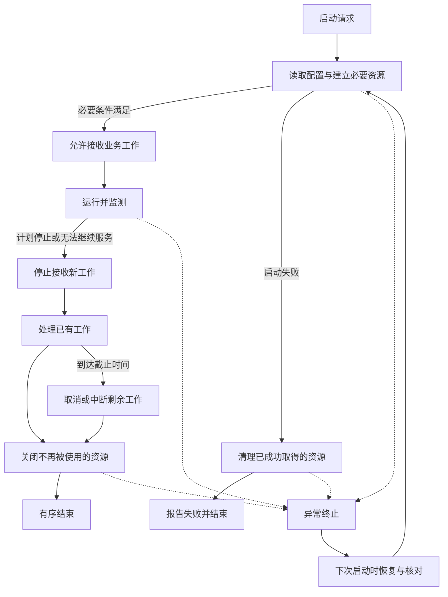

# 服务从启动到退出：通用模型与四条路径

阶段：权威资料与通用模型。资料核验日期：2026-10-29。

本文研究一个长期运行的服务实例，不展开整个集群的发布算法。正文是对多份资料的综合归纳，不是一份统一的行业生命周期标准。涉及 Linux 信号、HTTP 或 Kubernetes 时分别标明范围。尚未进行样本源码分析或运行实验。

阅读顺序：[概念与流程（本文）](foundations.md) → [来源与证据边界](sources.md) → [多项目源码带读提纲](reading-guide.md) → [横向比较](comparison.md) → 实验 → [自己的实践准则](practice.md)。

## 1. 先说清楚，我们究竟在管理什么

服务器生命周期不是单纯的“执行 main，最后关闭数据库”。它还包含两类约定：什么时候可以把工作交给这个实例，以及已经交给它的工作如何得到交代。

The Twelve-Factor App 的 Disposability 原则主张快速启动、优雅退出，并讨论了 Web 请求与队列任务的不同退出方式。这是工程方法论，不是所有协议、语言和部署平台共同遵守的标准。[原文](https://12factor.net/disposability)

本文把生命周期抽象为三个参与方的协作：

| 参与方 | 负责回答的问题 | 典型对象 |
| --- | --- | --- |
| 应用实例 | 我准备好了吗？手里还有多少工作？哪些资源还在被使用？ | 请求处理器、任务执行器、连接池 |
| 进程管理者 | 谁启动它？什么时候要求结束？超时后怎么办？ | 服务管理器、容器运行时、人工执行命令 |
| 工作分发者 | 什么时候把新工作交给它？什么时候停止？ | 客户端、负载均衡器、消息队列、调度器 |

这是本文的分析框架。单机服务可能由直接连接的客户端分发工作；并不是每个项目都有服务注册中心或 Kubernetes。

可以把它想成一家餐馆：店员到场不等于可以接单；停止叫号不等于没有外卖订单；关门也不等于厨房立刻断电。回到准确含义：应用、工作分发与资源使用是不同边界，往往不会在同一瞬间改变。

## 2. 先区分几个容易混淆的状态

| 概念 | 在本文中回答什么 | 不能据此推断什么 |
| --- | --- | --- |
| 进程存在 | 操作系统里是否还有这个进程 | 业务是否能正常处理 |
| 监听已建立 | 某个网络入口能否接受连接 | 依赖是否满足、所有路由是否可用 |
| 初始化完成 | 为当前职责约定的启动工作是否完成 | 之后永远健康 |
| 就绪 | 现在是否适合交付某类新工作 | 所有业务接口都必然成功 |
| 存活检查通过 | 按约定检查，是否无需通过重启恢复 | 数据库、外部依赖一定正常 |
| 正在排空 | 已开始停止新工作并处理已有工作 | 已经没有连接、请求或任务 |
| 已终止 | 进程执行已经结束 | 所有业务承诺都兑现、所有缓冲都已持久化 |

Kubernetes 明确区分 startup、liveness、readiness 探针：启动探针用于启动阶段；就绪探针参与是否接收流量的判断；存活探针用于决定是否重启。探针的具体机制属于 Kubernetes，本文借此强调不要将三个问题混为一个。[官方文档](https://kubernetes.io/docs/concepts/workloads/pods/probes/)

“初始化完成”不是一份统一清单。例如核心数据尚不可访问可能阻止接单，推荐内容缓存未预热则可能允许降级。哪些能力是必要条件，要由服务承诺决定。这个取舍是设计判断，后续需要在样本里核对。

监听也不必总在初始化最后发生：独立健康端口可以提前开启，某些部署还有 socket activation。本文要求的是必要条件未满足时，不把正常业务工作交给尚不能处理的组件，而非要求所有服务逐行执行同一份启动顺序。

systemd 的通知机制也区分启动完成和开始停止：对使用相应服务类型的应用，`READY=1` 和 `STOPPING=1` 可向管理器报告状态。它们是特定平台协议，不能直接当成通用状态 API。[sd_notify](https://www.freedesktop.org/software/systemd/man/latest/sd_notify.html)

## 3. 总览：四条路径共用一张地图

下面是本文整理的概念模型，箭头表达主要依赖关系，不要求所有阶段串行。检查失败、崩溃、强制终止也可能发生在清理途中。



排空阶段不等于停止一切活动：已有请求可能还要访问数据库，工作线程可能还要写入最终状态，协议处理仍要发送响应。

## 4. 路径一：正常启动——先明确能兑现什么，再宣布可用

下面是一个通用的研究顺序，不是引用某份资料中的强制标准。

### 4.1 确认启动输入与运行约束

确定运行模式、配置来源、必要参数与版本信息。对于缺少端口、无效路径等明确错误，通常应在接收业务工作前发现。

不要把“配置读到了”和“配置有效”混为一谈。也不要为了输出完整配置而暴露凭据。

### 4.2 建立可观察性与资源所有权

尽早具备报告启动失败的能力；正式日志系统尚未建立时，也应有基本错误输出。每成功取得一个资源，就明确谁负责释放它。

例如日志输出、数据库连接池、后台线程、临时目录都不是一句“程序退出会回收内存”能够概括的。应用拥有连接池不等于拥有远端数据库，退出时关闭的是自己的使用句柄，而不是替所有实例关闭公共服务。

### 4.3 按依赖关系完成必要初始化

用一个假设服务说明：

```text
配置 ──→ 数据库连接 ──→ 数据访问对象 ──→ 业务服务 ──→ 请求处理
  └──→ 日志
  └──→ 调度器 ──→ 后台任务
```

箭头在这里表示右侧的构造或运行依赖左侧；真实系统还要区分“构造时需要”和“处理任务时需要”。没有依赖的步骤可以并行，有依赖的步骤必须等待必要条件满足。

数据库迁移是否在进程内执行、依赖故障时立即退出还是有限重试、缓存是否阻塞就绪，都没有脱离场景的唯一答案。迁移也可能由独立发布步骤执行；连接对象创建成功未必意味着已完成一次真实可用性验证。

### 4.4 启动服务组件，建立可用边界

确认服务确实建立入口，而不仅是创建了一个对象或启动了异步函数。HTTP 端口占用、后台工作器启动失败，应有通路返回应用协调层。

什么时候可向管理者或分发者表达就绪，要与实际业务能力一致。之后也可能因为运行故障而暂时不就绪。本文将就绪看作一个可重新评估的判断，而非在启动时写入一次的永久成功标记。

### 4.5 进入受监督的运行状态

启动成功不代表协调工作结束。关键组件后来失败时，需要决定恢复、降级、停止接单或终止实例。普通业务错误则不应自动等同于整个进程不可用。

这一部分后续在源码里要找的是：谁观察服务组件的错误，错误如何传到拥有决策权的地方；不能仅凭“某处有 goroutine”判断存在监督机制。

## 5. 路径二：启动失败——清理取得的资源，而非幻想所有状态都能回滚

假设数据库句柄已经建立，调度器已经启动，随后 HTTP 监听因端口占用失败。

```text
数据库已就绪 → 调度器已启动 → HTTP 监听失败
                           ↓
                阻止继续启动并处理已启动工作
                           ↓
                   关闭已取得的资源
                           ↓
                 报告根因，以失败状态结束
```

从这个例子可以提出四个设计要求，均待在样本与实验中检验：

1. 清理应覆盖部分成功，不能假设所有字段都初始化了。
2. 初始化函数部分失败时，也要约定由它自己清理局部资源，还是交给调用方。
3. 后创建的使用者往往先停止，但关闭顺序应根据使用关系决定；“所有资源严格倒序”只是某些依赖结构下的简化。
4. 保留最初失败原因，同时报告清理中的错误；不要让清理错误把启动根因完全遮住。

**资源清理和外部业务副作用回滚是两件事。** 关掉连接池不会撤销已提交的迁移，也不会撤回已发出的消息。存在外部副作用时，要分别考虑事务、补偿、幂等或下次恢复，不把一份清理函数列表当成全系统事务。

如果该进程不应在初始化阶段执行真实任务，就应推迟任务接收；如果业务选择提前执行，则失败路径还必须处理这些在途任务。

## 6. 路径三：正常退出——控制新工作，再给已有工作交代

### 6.1 停止请求只是触发事件，不是清理实现

停止来源可以是管理命令、部署替换或关键组件失败。对于 Linux，SIGTERM 的默认动作是终止；应用要采用自己的协调逻辑，必须正确接入相应通知。SIGKILL 无法被捕获、阻塞或忽略，因此不能依赖在它之后执行应用清理。[Linux signal(7)](https://man7.org/linux/man-pages/man7/signal.7.html)

这里的具体信号语义限定为 Linux；Windows 服务和控制台的通知机制需要另行研究。语言层的处理 API 留到 Go 实现阶段。

### 6.2 停止接收新工作：至少检查三个入口

| 入口 | 退出时要考虑什么 |
| --- | --- |
| 外部工作分发 | 流量摘除、服务发现更新、停止领取新消息 |
| 实例本地接收 | 新连接、新请求、新任务是否还被接纳 |
| 已有会话内部 | 长连接是否还能提交新请求或新消息 |

这些是分析维度，不要求每个服务都有全部入口。设为不就绪并不直接执行应用内部清理；只关闭监听也不直接等于所有存量连接和工作已经消失。

Kubernetes 的终止流程涉及节点上的关闭操作与控制面的端点更新，两者并非一条全局同步的串行调用链。不能因为应用改变了一个状态，就推断所有流量来源已在同一瞬间停止分发。[Pod 终止流程](https://kubernetes.io/docs/concepts/workloads/pods/pod-lifecycle/#pod-termination-flow)

### 6.3 协议不同，排空方式也不同

HTTP/1.1 的连接可以被复用；RFC 9112 的 `Connection: close` 用于表达当前响应之后关闭连接。它是连接级协议语义，不是整个应用退出的 API。[RFC 9112 §9.3、§9.6](https://www.rfc-editor.org/rfc/rfc9112.html#section-9.6)

HTTP/2 在一个连接中管理多个流；GOAWAY 允许一端停止接收新流，同时继续处理已建立的流。它说明为什么排空不能只理解为“断开 TCP 连接”。具体框架是否正确实现，需要在源码中验证。[RFC 9113 §6.8](https://www.rfc-editor.org/rfc/rfc9113.html#section-6.8)

对 WebSocket、持续推送和长期任务，要另行规定：在何时通知对方、如何重连、需要保存哪些进度、何时中断。这里先提出研究问题，不宣称它们共用 HTTP 短请求的退出保证。

### 6.4 决定已有工作如何收尾

“优雅”不是无限等待，更不是把所有工作同时取消。本文建议按工作承诺分类：

| 工作 | 可研究的策略 | 必须说明的边界 |
| --- | --- | --- |
| 有明确短时限的请求 | 允许在剩余期限内完成 | 期限到达后如何失败 |
| 长连接或持续流 | 通知、迁移或关闭，并允许重连 | 是否丢失会话状态或消息 |
| 有可靠队列的任务 | 完成并确认，或按队列协议释放、归还 | 是否可能重复、怎样保证幂等 |
| 仅在内存中的任务 | 尽力完成、持久化或放弃 | 能否接受进程消失后的任务丢失 |
| 定时调度 | 停止触发新任务，处理正在运行的任务 | 多实例与重复执行如何处理 |

这是设计选项表，不是已验证实现。Twelve-Factor 对工作器讨论了归还任务与幂等的关系，但具体确认、重投与恢复语义必须以所选队列为准。[Disposability](https://12factor.net/disposability)

### 6.5 按使用关系释放资源

假设已有请求仍在提交事务，先关闭它需要的数据库连接池，就可能破坏本来能够完成的请求。后台任务也可能持有同样的依赖。

因此一个候选顺序是：停止新请求与新任务 → 等待或中断已有工作 → 确认使用者已停止 → 关闭相关客户端与资源 → 尽力导出剩余诊断信息 → 结束。独立组件可以并行收尾，真实顺序由依赖图和时间预算确定。

通知取消不等于已经停止，调用关闭也未必等于后台活动结束。需要找到可观察的完成条件。清理失败应被记录并按影响处理，不应不加判断地跳过其他独立资源的清理。

诊断信息的刷新不能无界等待；关键业务数据的持久化保证也不应全部推迟到这一刻。这是下节讨论异常终止的原因。

### 6.6 退出预算由外向内约束

Docker stop 通常先发停止信号，再在配置的期限后强制终止；停止信号与期限均可配置。[Docker 官方文档](https://docs.docker.com/reference/cli/docker/container/stop/)

Kubernetes 中 preStop 也消耗终止宽限期，不能等应用收到停止信号后再假设拿到了完整的新预算；细节依平台配置和运行环境核对。[Pod 终止流程](https://kubernetes.io/docs/concepts/workloads/pods/pod-lifecycle/#pod-termination-flow)

据此可以提出一个预算原则：以外层可能强制结束的截止时间为上界，减去已经消耗的时间和必要余量；应用剩余收尾的关键路径必须能放进去。不能给每个组件都单独用一份完整总时限，然后串行等待。

假设外层总窗口为 30 秒，前置操作用去 5 秒，计划将剩余时间分配为：在途工作最多 18 秒，资源关闭最多 3 秒，预留 4 秒。这只是串行模型的算术示例，不是实验结果或推荐默认配置。并行收尾按关键路径计算，也要考虑共享资源与调度延迟。

达到截止时间后，剩余工作可能被中断。退出设计应明确此时如何恢复或重试，而非承诺所有请求必然成功。

## 7. 路径四：异常终止——没有清理机会时，谁保护业务承诺

有序停止依赖应用还能够运行协调代码。强制终止、进程崩溃、机器掉电或严重故障，都可能打断这个条件；不能假定上述清理步骤一定执行。

George Candea 与 Armando Fox 在 HotOS IX（2003）的《Crash-Only Software》中提出以崩溃安全和快速恢复组织系统，强调重要状态存储以及超时、租约、重试等机制。论文提出了更强的 crash-only 设计，并非要求所有现有应用直接取消优雅退出。[原始论文，第 1、3 节](https://www.usenix.org/legacy/events/hotos03/tech/full_papers/candea/candea.pdf)

本文吸收的是它提出的审查方向：正常退出减少计划内中断，恢复设计处理退出逻辑没有机会完成的情况。具体到一个假设的订单服务：

| 突然终止的位置 | 下次运行或调用方面临的问题 |
| --- | --- |
| 数据仍只在进程内存 | 如果此前已承诺持久接收，凭什么恢复？ |
| 数据库已提交，响应尚未送达 | 客户端不知道结果，重试会不会重复创建？ |
| 外部副作用已执行，任务尚未确认 | 再次投递会不会重复扣款、发货或通知？ |
| 处理进度写了一半 | 状态是否足以识别未完成操作并恢复？ |

这是用于推理的假设案例，不是任何样本的实际事故。解决方式与业务契约有关，可能需要事务、唯一约束、幂等键、可靠任务存储或对账；仅捕获退出信号不能解决这些问题。

同样，重试不是自动安全的。是否能重试、如何识别重复、哪些结果仍然未知，需要请求和业务层明确约定。

## 8. 用一个连续例子，把四条路径串起来

假设我们要提供“保存笔记并在后台建立索引”的服务。以下全部是教学场景，不是 Memos 的实现描述。

1. 正常启动：读取有效配置，确认必要数据访问能力，准备业务处理，建立网络入口，按约定允许接单。索引是否必须预热，由查询承诺决定。
2. 启动失败：数据访问已创建，但监听失败；停止已经启动的后台工作，清理取得的资源，保留原始错误。不能因此撤销所有已发生的数据更改。
3. 正常退出：停止新请求和新索引任务，给已接收请求与在途索引工作设定处理策略，使用者停止后再关闭依赖，在截止时间前结束。
4. 异常终止：某条笔记已保存但响应未到达，或者索引只完成一部分；下次运行依靠可识别状态、恢复与幂等约定处理，不等待一段永远不会执行的退出代码。

四条路径应共同设计。只实现第一条，得到的是能启动的程序；检查其余路径，才能理解这个实例如何与外部系统可靠配合。

## 9. 从资料中归纳出的第一组问题

下面是后续读代码与做实验的判断问题，尚不是本项目已经验证的实现准则：

- 谁拥有生命周期决策权，谁只能报告失败？
- 哪些条件阻止接单，哪些允许降级运行？
- 谁创建资源，谁使用，谁等待使用者结束，谁关闭？
- 启动部分成功、运行组件失败、计划停止是否汇入一致的协调路径？
- 工作分发与本地接收如何分别控制？存量会话能否继续带来新工作？
- 哪些工作允许完成，哪些要求取消、归还、持久化或恢复？
- 谁给出最外层截止时间，内部阶段怎样共享剩余预算？
- 如果清理根本没有执行，哪些业务承诺仍成立，凭什么？
- 如何观察并验证这些行为，而不是仅看“退出成功”的日志？
