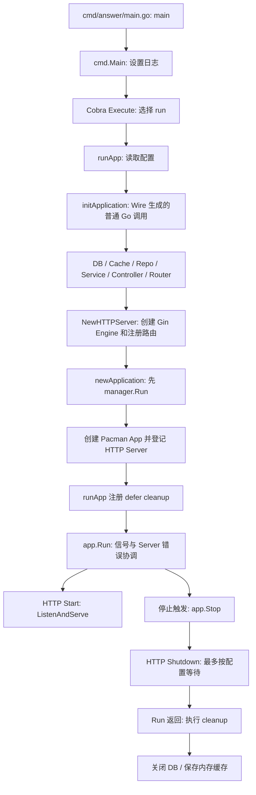

# Answer 源码带读：从入口到 HTTP 退出，谁管理了哪些工作

状态：静态源码分析完成第一轮；未编译、未启动服务、未执行退出实验。核验日期：2026-10-29。

本轮基线为 Apache Answer **v2.0.3**，完整 SHA 为 `6744295fa888e0621fc9f9a8ace04f1a4daf8554`。分析的是标准构建与 `answer run` 路径，同时查看仓库 Docker 入口和 Helm 部署模板；不覆盖用户自行编译的插件及外部部署改造。

先读 [通用模型](../foundations.md)。本篇以具体调用链解释实现，证据列表与依赖基线保存在 [answer.sources.json](answer.sources.json)。下方源码链接均固定版本；

## 1. 先拿到整张调用地图

Answer 将工作分给几种不同角色：Cobra 选择命令；Wire 生成依赖装配代码；Gin 负责 HTTP 处理链；Pacman 管理登记的 Server 的启动与关闭；Answer 自己创建的数据和后台工作，需要另外接入清理。



图中 HTTP 启动在 goroutine 内，停止可能由信号、外层 context 或 Server 错误触发；不是单一路径的同步调用。Cron、队列等后台活动并不因为出现在装配图里，就自动成为 Pacman 管理的 Server。

## 2. 从真正的入口进入：运行的是哪个命令

[Makefile][A_BUILD] 指定构建目录 `./cmd/answer`。[该目录的 main][A_ENTRY] 调用 `answercmd.Main()`；后者在 [cmd/main.go][A_MAIN] 中设置全局日志，再调用 `Execute()`。

[cmd/command.go][A_COMMAND] 使用 Cobra 定义 `init`、`run`、`upgrade` 等子命令。`run` 的关键动作是：按 `--data-path` / `-C` 整理路径，然后执行 `runApp()`。因此只读 `main()` 还无法知道服务怎么启动，必须继续追到实际命令。

适合定位服务路径的命令示意是 `answer run -C <数据目录>`，不是本轮已执行的命令。首次安装的前置条件与配置仍需按项目说明准备。

这里有两个不同的层次：

- `answer run` 是单次应用服务运行路径。
- 容器的 [entrypoint.sh][A_ENTRYPOINT] 依次调用 `answer init`、`answer upgrade`、`answer run -C /data/`，是多个命令构成的启动安排。

不能把“容器启动会执行 upgrade”写成“runApp 必然自动迁移数据库”。`upgrade` 的实现属于独立 Cobra 命令，当前也没有因为迁移返回失败就必然阻止后续脚本语句执行的统一错误传播保证。

## 3. runApp 是应用外层的协调点

按 [runApp][A_RUN] 的实际顺序阅读：

1. `conf.ReadConfig(path.GetConfigFilePath())`。
2. `initApplication(...)`，取得 `app`、`cleanup`、`error`。
3. 初始化版本信息和应用启动时间，打印版本。
4. 注册 `defer cleanup()`。
5. 调用 `app.Run(context.Background())`；返回错误时 panic。

下面是保留关键原始语句、删去参数细节和元数据赋值的摘录；完整实现以链接为准：

```go
c, err := conf.ReadConfig(path.GetConfigFilePath())
if err != nil {
    panic(err)
}
// 此处省略 initApplication 的参数与错误分支
defer cleanup()
if err := app.Run(context.Background()); err != nil {
    panic(err)
}
```

最值得留意的是 `defer` 的注册位置：**它发生在依赖装配成功返回之后。** 如果已经进入 app.Run，正常返回或者该 goroutine 中的 panic 展开栈时，可以走到已经登记的 cleanup；如果还在 initApplication 内发生 panic，runApp 里的这条 defer 尚未登记。

这解释了为什么不能只数“代码里有几处 defer”，而要查清注册时间与负责的范围。本文未通过故障注入验证这些分支。

配置读取在 [conf.ReadConfig][A_CONF] 中经过 Viper 解析、默认值和部分环境变量覆盖。本篇只记录其启动位置；配置优先级、完整校验与日志初始化细节留到相应模块，不扩大本轮结论。

## 4. Wire 如何把依赖图变成实际代码

先看 [cmd/wire.go][A_WIRE_SPEC]：它声明 providers，并带有 `wireinject` 构建约束。正常构建实际使用 [cmd/wire_gen.go][A_WIRE_GEN] 的生成结果。因此理解当前顺序时，以生成代码为直接证据，而不只研究 provider 列表。

Wire 在这里提供代码生成；应用运行时执行的是普通 Go 构造函数调用，不是每次启动都动态分析整个依赖图。

生成代码可分成三段阅读：

| 阶段 | 实际发生什么 | 证据 |
| --- | --- | --- |
| 基础依赖 | 静态路由对象、翻译、NewDB、NewCache、NewData | [装配前段][A_WIRE_HEAD] |
| 业务对象 | Repo、Service、Controller；部分构造函数已经启动队列工作器 | [装配中的队列][A_WIRE_QUEUES] |
| HTTP 与应用 | 创建 Gin Engine、调度管理器，调用 newApplication，返回 cleanup | [装配尾段][A_WIRE_TAIL] |

这里把“构造对象”和“开始运行”区分开十分重要：NewHTTPServer 只创建路由处理对象，但 queue.New 会启动工作 goroutine。不能假设所有名为 New 的函数都是无副作用的装配。

### 4.1 数据库确实进行了 Ping

[data.NewDB][A_DB] 创建 xorm Engine 后调用 `engine.Ping()`，成功后再设置连接池参数等。我们因此可以确认它不只创建句柄，也在启动路径里尝试验证数据库连接。

不过 Ping 成功只证明该次检查通过；它不证明所有表都已迁移，也不保证稍后的业务查询必然成功。启动检查与持续可用性要分别分析。

### 4.2 cleanup 是 provider 提供的能力，不是 Wire 自动猜出来的

[data.NewData][A_DATA_CLEANUP] 返回一个调用 `db.Close()` 的清理函数；[data.NewCache][A_CACHE] 返回保存缓存的清理函数，插件缓存分支则返回空清理。

生成代码最终组合的是：

```go
return application, func() {
    cleanup2()
    cleanup()
}, nil
```

该摘录来自 [wire_gen.go 末尾][A_WIRE_TAIL]。在本基线里，`cleanup2` 对应关闭数据库，`cleanup` 对应缓存 provider 的清理。生成结果中没有替所有队列和 Cron 自动补出停止、等待代码。

## 5. HTTP 何时开始服务，健康检查表达了什么

[NewHTTPServer][A_HTTP] 创建 `gin.Engine`，安装中间件、模板、业务路由、插件入口等，然后返回 Engine。此函数没有负责调用 `ListenAndServe`。

随后 [newApplication][A_NEW_APP] 将 Engine 包装为 Pacman 的 HTTP Server，并通过 `pacman.WithServer(...)` 登记。真正的监听发生在 Pacman HTTP 包的 [Server.Start][P_HTTP_START]，调用标准库 `ListenAndServe()`。

这三种对象应分别理解：

| 对象 | 作用 | 是否等同已经监听 |
| --- | --- | --- |
| Gin Engine | 请求处理与路由 | 否 |
| Pacman HTTP Server | 持有 net/http.Server，提供 Start/Shutdown | 构造成功仍不等于监听成功 |
| 正在运行的监听与连接 | 操作系统与 HTTP 运行状态 | 实际开始服务还要看启动结果 |

此版本有 `/healthz` 路由，它的处理器直接返回 200 和 OK，没有在处理器内检查数据库或排空状态。[路由定义][A_HEALTH]

仓库自带 [Helm Deployment][A_CHART] 的 livenessProbe 与 readinessProbe 则均请求 `/`，没有使用 `/healthz`。这不等于两个检查已具备不同语义，也不能从这个模板推断用户实际部署配置。本文没有展开 `/` 的所有渲染依赖，不能将该探针直接描述成完整的业务依赖检查。

在本轮入口、HTTP 包、配置和部署模板的检索范围内，没有找到独立的“正在排空”的就绪状态切换接线。这是注明范围的静态观察，不是声称项目的每一种部署都没有流量摘除机制。

## 6. Cron 在监听前启动，而且还同步做了一次业务工作

[newApplication][A_NEW_APP] 的第一句是 `manager.Run()`，之后才构造 Pacman Application。[ScheduledTaskManager.Run][A_CRON] 先直接调用一次 `SitemapCron(context.Background())`，再创建调度器、注册任务并 `c.Start()`。

这会带来两个值得观察的时序：

- 首次 SitemapCron 的同步调用发生在 app.Run 之前；它返回前，后面的 HTTP 监听还没开始。
- Cron 开始调度后，initApplication 才最终返回；在 runApp 注册 cleanup 前，已有部分后台活动存在。

这是代码顺序的判断，不是启动延迟的实测。SitemapCron 的实际耗时、失败影响与调用内部的行为需继续验证。

该函数将 `c := cron.New()` 保存在局部变量，ScheduledTaskManager 结构里没有持有它，也未提供 Stop 方法接入最终 cleanup。锁定的 robfig/cron 版本其实提供 [Stop][C_STOP]，并通过返回 context 允许等待运行中的任务；此应用路径没有调用它。

任务使用独立的 `context.Background()`，不是从 app.Run 的 context 派生。因此不能因为上层存在一个 context，就认为它会取消这些定时任务。

## 7. 真正的停止触发在 Pacman，必须读锁定依赖

Answer 的 [go.mod][A_MOD] 锁定 Pacman 及其 HTTP 子模块到 `c0075a2d401f` 对应版本。已解析完整提交为 `c0075a2d401f2ffd8558ff6257a10381da46a4c2`；本篇使用该提交，而非 Pacman 默认分支。

[pacman.NewApp][P_DEFAULTS] 的默认信号是 SIGTERM、SIGQUIT、SIGINT。[Application.Run][P_RUN] 做了三件事：

1. 登记信号通知，创建错误 channel。
2. 为登记的每个 Server 启动一个 goroutine，执行 Start；错误写入错误 channel。
3. select 等待 Server 错误、外层 context 结束、停止信号，然后调用 Stop。

对 Answer 来说，传入的是 `context.Background()`，因此外层 context 本身没有主动取消时机；直接运行时的常见停止入口是信号，HTTP 启动错误也会触发返回。

这条监督链只覆盖登记的 Server。Cron、通用业务队列没有通过 WithServer 登记；它们的业务失败也不因此自动进入 errCh。

[Application.Stop][P_STOP] 并行调用各 Server 的 Shutdown，用 WaitGroup 等待调用返回。错误只写日志，Stop 最后返回 nil。这里的 WaitGroup 等待的是“登记的 Server 关闭调用”，不是扫描并等待整个进程的所有 goroutine。

## 8. HTTP Shutdown 到底保证到哪一步

锁定版本的 [Pacman HTTP Shutdown][P_HTTP_SHUTDOWN] 用 `context.WithTimeout(context.Background(), s.ShutdownTimeout)` 调用 `http.Server.Shutdown(ctx)`。默认超时为一分钟；Answer 的包装处没有传 WithShutdownTimeout，HTTP 配置结构也只包含 Addr。[默认配置][P_HTTP]、[Answer 包装处][A_NEW_APP]、[配置结构][A_SERVER_CONFIG]

理解这段代码需要看标准库，而不根据 Shutdown 的名字猜测行为。本文读取 Go 1.25.0 的 [net/http/server.go][G_HTTP]，作为与项目最低 Go 版本对应的语义参考；未构建二进制，不能据此宣称实际发行制品使用了该工具链。

标准库 Shutdown 会关闭监听、处理空闲连接，并等待活动连接回到可关闭状态；context 到期则返回错误。它不等于超时后自动强制关闭全部活动连接，也不负责所有被 hijack 的连接。实际协议与框架版本仍需运行验证。

因此，当前代码允许推导出这样的分支：

```text
收到停止信号
  → Pacman Stop
  → HTTP Shutdown
      ├─ 等待完成 → 返回
      └─ 等待超时 → 返回错误 → Pacman 仅记录日志
  → Stop 返回 nil
  → runApp 执行数据库和缓存 cleanup
  → 返回到 main，进程结束
```

**静态推断：** 若 HTTP 等待超时，仍活动的处理器可能还没有结束，数据库清理却已继续执行。本轮没有复现请求失败或数据损失，不应把这一潜在时序写成已发生事故。

另一个边界是外层时间预算：一分钟是库的内部等待上限，不等于容器平台会给进程完整一分钟。部署的总期限需要另行核对。最终数据 cleanup 也没有共享这个一分钟 context，因此它不是整个进程退出的总时限。

## 9. 队列有 Close，为何仍不能断言它会排空

[queue.New][A_QUEUE_NEW] 创建 buffered channel，并启动工作 goroutine；[Queue.Close][A_QUEUE_CLOSE] 则关闭 channel，等待工作 goroutine 完成。处理消息时使用 `context.TODO()`，没有从应用根 context 派生的取消预算。

生成装配代码构造了 activity、event、notification、external notification 和 vector sync 等队列。[装配位置][A_WIRE_QUEUES]、[vector sync 构造][A_VECTOR]

本轮对固定版本全部非测试 Go 文件检索 `.Close(`、`.Stop(`、`Shutdown(`，并结合生成的 cleanup 核对：**主应用退出链没有找到这些队列 Close 的调用。** 单独队列测试会调用 Close，不能把组件测试里的调用当成主应用生命周期接线。

内存缓存配置了文件路径时，还有一个每分钟 Save 的后台循环。它未持有应用取消信号，缓存 cleanup 也没有停止并等待该循环。[缓存实现][A_CACHE]

此外，通知模块还有专用的新问题邮件 worker：提供自己的 Close，取消后等待并处理剩余待发任务；本轮非测试代码检索没有找到其 Close 接入主退出路径的调用。[邮件 worker][A_EMAIL]

Go 规范说明，main 返回时程序结束，不会等待其他非 main goroutine。因此主生命周期是否显式等待后台工作十分重要。[语言规范](https://go.dev/ref/spec#Program_execution)

这几类实现共同展示一个可迁移的观察：**局部可关闭、全局有协调、实际调用关闭，是三个需要分别取证的问题。** 实际影响取决于队列积压、运行中的任务及业务恢复方式，留到实验阶段检验。

## 10. 将 Answer 放回四条生命周期路径

| 通用路径 | 本版本已确认的实现 | 边界与待验证问题 |
| --- | --- | --- |
| 正常启动 | Cobra → 配置 → Wire 装配 → Cron → Pacman HTTP Start | 构造期间已存在后台活动；没有独立统一的业务就绪握手 |
| 启动失败 | 配置、装配错误使用 panic；HTTP Start 错误经 Pacman Stop 返回，再触发已登记的 defer cleanup | initApplication 成功前尚无 runApp 的 defer；不能认为每种部分失败都完整回滚 |
| 正常退出 | Pacman 信号/错误/context → HTTP Shutdown → Wire cleanup | HTTP 超时错误只记日志；Cron、队列不在同一停止等待链 |
| 异常终止 | 内存队列和可选缓存文件可从代码观察到 | 本轮没有完整分析各业务的持久化与恢复，不能声称所有任务可靠重放或所有数据丢失 |

再看一个局部失败例子：[NewDB][A_DB] 在 Ping 失败分支直接返回 error，此函数中没有先显式调用 engine.Close。这个分支需要进一步结合 xorm 行为和实验核对，不能仅凭局部代码断言真实资源泄漏。生成器只能组合 provider 提供的清理，不能替 provider 推导所有局部失败语义。

## 11. 容器入口也属于研究范围，但不能只靠脚本推断信号实况

[Dockerfile][A_DOCKER] 的 ENTRYPOINT 指向 Bash 脚本，脚本最后一行是普通 `/usr/bin/answer run ...`，没有显式 exec。镜像安装了 dumb-init，但该 Dockerfile 的入口没有直接使用它。

这是静态事实。它提醒我们后续需要实际观察 PID 1、进程树以及信号到达对象；Bash、运行方式和平台可能影响行为。本文没有运行容器，所以不直接断言容器信号必定无法到达应用，也不承诺容器停止必然走到 Pacman。

同样，Helm 模板没有声明应用专用的退出总预算或 preStop 接线；外部平台的配置不能由库的一分钟默认值代替。


[A_BUILD]: https://github.com/apache/answer/blob/6744295fa888e0621fc9f9a8ace04f1a4daf8554/Makefile#L3-L22
[A_ENTRY]: https://github.com/apache/answer/blob/6744295fa888e0621fc9f9a8ace04f1a4daf8554/cmd/answer/main.go#L35-L37
[A_MAIN]: https://github.com/apache/answer/blob/6744295fa888e0621fc9f9a8ace04f1a4daf8554/cmd/main.go#L69-L73
[A_COMMAND]: https://github.com/apache/answer/blob/6744295fa888e0621fc9f9a8ace04f1a4daf8554/cmd/command.go#L90-L113
[A_ENTRYPOINT]: https://github.com/apache/answer/blob/6744295fa888e0621fc9f9a8ace04f1a4daf8554/script/entrypoint.sh#L19-L21
[A_RUN]: https://github.com/apache/answer/blob/6744295fa888e0621fc9f9a8ace04f1a4daf8554/cmd/main.go#L75-L95
[A_CONF]: https://github.com/apache/answer/blob/6744295fa888e0621fc9f9a8ace04f1a4daf8554/internal/base/conf/conf.go#L98-L114
[A_WIRE_SPEC]: https://github.com/apache/answer/blob/6744295fa888e0621fc9f9a8ace04f1a4daf8554/cmd/wire.go#L1-L69
[A_WIRE_GEN]: https://github.com/apache/answer/blob/6744295fa888e0621fc9f9a8ace04f1a4daf8554/cmd/wire_gen.go#L128-L320
[A_WIRE_HEAD]: https://github.com/apache/answer/blob/6744295fa888e0621fc9f9a8ace04f1a4daf8554/cmd/wire_gen.go#L131-L149
[A_WIRE_QUEUES]: https://github.com/apache/answer/blob/6744295fa888e0621fc9f9a8ace04f1a4daf8554/cmd/wire_gen.go#L183-L206
[A_WIRE_TAIL]: https://github.com/apache/answer/blob/6744295fa888e0621fc9f9a8ace04f1a4daf8554/cmd/wire_gen.go#L313-L320
[A_DB]: https://github.com/apache/answer/blob/6744295fa888e0621fc9f9a8ace04f1a4daf8554/internal/base/data/data.go#L56-L95
[A_DATA_CLEANUP]: https://github.com/apache/answer/blob/6744295fa888e0621fc9f9a8ace04f1a4daf8554/internal/base/data/data.go#L46-L53
[A_CACHE]: https://github.com/apache/answer/blob/6744295fa888e0621fc9f9a8ace04f1a4daf8554/internal/base/data/data.go#L98-L138
[A_HTTP]: https://github.com/apache/answer/blob/6744295fa888e0621fc9f9a8ace04f1a4daf8554/internal/base/server/http.go#L36-L126
[A_HEALTH]: https://github.com/apache/answer/blob/6744295fa888e0621fc9f9a8ace04f1a4daf8554/internal/base/server/http.go#L63-L66
[A_NEW_APP]: https://github.com/apache/answer/blob/6744295fa888e0621fc9f9a8ace04f1a4daf8554/cmd/main.go#L97-L104
[A_CRON]: https://github.com/apache/answer/blob/6744295fa888e0621fc9f9a8ace04f1a4daf8554/internal/base/cron/cron.go#L62-L119
[A_MOD]: https://github.com/apache/answer/blob/6744295fa888e0621fc9f9a8ace04f1a4daf8554/go.mod#L20-L72
[A_QUEUE_NEW]: https://github.com/apache/answer/blob/6744295fa888e0621fc9f9a8ace04f1a4daf8554/internal/base/queue/queue.go#L52-L61
[A_QUEUE_CLOSE]: https://github.com/apache/answer/blob/6744295fa888e0621fc9f9a8ace04f1a4daf8554/internal/base/queue/queue.go#L89-L128
[P_DEFAULTS]: https://github.com/segmentfault/pacman/blob/c0075a2d401f2ffd8558ff6257a10381da46a4c2/pacman.go#L28-L45
[P_RUN]: https://github.com/segmentfault/pacman/blob/c0075a2d401f2ffd8558ff6257a10381da46a4c2/pacman.go#L83-L110
[P_STOP]: https://github.com/segmentfault/pacman/blob/c0075a2d401f2ffd8558ff6257a10381da46a4c2/pacman.go#L113-L127
[P_HTTP]: https://github.com/segmentfault/pacman/blob/c0075a2d401f2ffd8558ff6257a10381da46a4c2/contrib/server/http/http.go#L13-L46
[P_HTTP_START]: https://github.com/segmentfault/pacman/blob/c0075a2d401f2ffd8558ff6257a10381da46a4c2/contrib/server/http/http.go#L49-L56
[P_HTTP_SHUTDOWN]: https://github.com/segmentfault/pacman/blob/c0075a2d401f2ffd8558ff6257a10381da46a4c2/contrib/server/http/http.go#L58-L63
[C_STOP]: https://github.com/robfig/cron/blob/ccba498c397bb90a9c84945bbb0f7af2d72b6309/cron.go#L323-L340
[G_HTTP]: https://github.com/golang/go/blob/6e676ab2b809d46623acb5988248d95d1eb7939c/src/net/http/server.go#L3159-L3227
[A_CHART]: https://github.com/apache/answer/blob/6744295fa888e0621fc9f9a8ace04f1a4daf8554/charts/templates/deployment.yaml#L50-L67
[A_SERVER_CONFIG]: https://github.com/apache/answer/blob/6744295fa888e0621fc9f9a8ace04f1a4daf8554/internal/base/server/config.go#L19-L31
[A_VECTOR]: https://github.com/apache/answer/blob/6744295fa888e0621fc9f9a8ace04f1a4daf8554/internal/service/vector_sync/vector_sync.go#L49-L58
[A_EMAIL]: https://github.com/apache/answer/blob/6744295fa888e0621fc9f9a8ace04f1a4daf8554/internal/service/notification/new_question_email_worker.go#L101-L189
[A_DOCKER]: https://github.com/apache/answer/blob/6744295fa888e0621fc9f9a8ace04f1a4daf8554/Dockerfile#L49-L74
