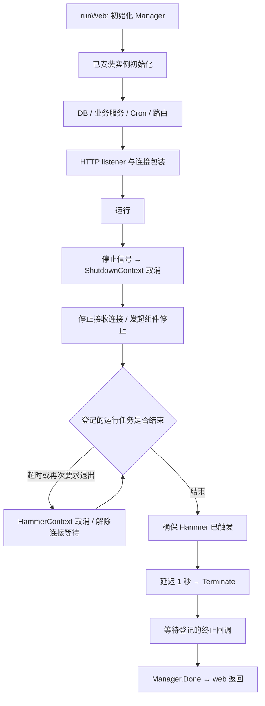

# Gitea 源码带读：把退出拆成 Shutdown、Hammer 和 Terminate

状态：第一轮静态源码分析；未构建运行、未执行退出实验。核验日期：2026-10-30。

基线：**v28.2.0**，完整 SHA `829b49c1ae96015e345f9d2a0eb1ea7acd5f31e1`。主线选择已安装实例的 web/HTTP 服务；Unix 信号与 systemd 通知为主要平台分支，Windows 服务仅补充边界。SSH、Actions、队列与热重启未全面审计。[证据清单](gitea.sources.json)

## 1. 先读三层，而不是追进全部初始化函数

Gitea 有大量业务组件，逐个追到底会掩盖本主题。先建立这三层导航：

| 层次 | 固定版本入口 | 本轮要回答的问题 |
| --- | --- | --- |
| 应用装配 | [runWeb][GT_WEB] → [serveInstalled][GT_INSTALLED] → [InitWebInstalled][GT_INIT] | 哪些准备发生在监听之前？ |
| 生命周期协调 | [Manager.prepare][GT_MANAGER]、[doShutdown][GT_SHUTDOWN] | 谁接收停止，谁等待完成？ |
| 具体参与者 | [HTTP 包装][GT_HTTP]、[Server.Serve][GT_SERVE]、[Cron][GT_CRON] | 一个服务怎样参加这个协议？ |



这是正常受管退出的关系图。Hammer 不保证能让不合作的业务函数返回，初始化失败也未必经过整张图。

## 2. 装配顺序：先建立依赖，再开始接收业务

[runWeb][GT_WEB] 先创建 Manager，初始化页面模板，依据 InstallLock 选择是否先运行安装页，最后进入已安装实例主线。安装模式与正常模式不是同一段准备流程，本篇以正常模式为准。

[InitWebInstalled][GT_INIT] 依次初始化 Git、语言与配置、存储、邮件与缓存等，调用 common.InitDBEngine，随后初始化模型与认证服务，再启动镜像同步、Webhook、索引等后台活动，最后启动 Cron。[serveInstalled][GT_INSTALLED] 在这些步骤之后建立 NormalRoutes，并调用 listen。

数据库入口不是单次 Open 就结束。[InitDBEngine][GT_DB] 按配置重试；[InitEngineWithMigration][GT_ENGINE] 创建 XORM engine、Ping、执行迁移回调、同步表并调用已登记的初始化函数。它们位于正常实例的业务监听之前。

两个容易误读的地方：

- InitWebInstalled 使用的 `mustInit` / `mustInitCtx` 在出错时调用 log.Fatal。不能因为 Manager 已创建，就认定所有初始化失败都会按分阶段协议回滚。
- retry 在每轮开始检查 ctx，但两轮之间是 `time.Sleep`。取消检查不意味着退避等待会立即中断。且此处传入的是 HammerContext，普通 Shutdown 与 Hammer 的时间点不同。[初始化调用][GT_INIT]、[重试代码][GT_DB]

本版 go.mod 声明 Go 1.27、XORM v1.4.3、gocron/v2 v2.22.0。HTTP 在标准库外包了一层自身的 graceful.Server。[依赖基线][GT_MOD] 本篇分析其接线，不把框架规模当成设计质量的结论。

## 3. 四个 context，表达四种完成语义

[Manager.prepare][GT_MANAGER] 从同一个基础 context 分别派生 Shutdown、Hammer、Terminate、Manager context。它们是并列派生，阶段顺序由 Manager 主动调用 cancel 来组织，并不是通过“父取消自然级联”实现正常分阶段退出。

| 阶段 | 代码中的动作 | 业务含义与限制 |
| --- | --- | --- |
| Shutdown | 取消 shutdownCtx；异步执行停止回调 | 发出开始收尾的通知 |
| Hammer | 取消 hammerCtx | 请求进一步中断，具体效果取决于使用者 |
| Terminate | 取消 terminateCtx；异步执行终止回调 | 运行任务阶段之后释放登记的终止资源 |
| Manager.Done | 等待终止回调完成后取消 managerCtx | 受管退出的最后完成信号 |

对照 [doShutdown][GT_SHUTDOWN] 来读：它启动 Hammer 计时，同时等待 runningServerWaitGroup。运行任务都结束后，它确保 Hammer 已触发，等待一秒，进入 Terminate，再等待 terminateWaitGroup，最后取消 Manager context。[Hammer][GT_HAMMER]、[Terminate][GT_TERMINATE]

这也解释了为什么不能把“GracefulHammerTime 默认 60 秒”读成“服务最多 60 秒退出”。这个配置是升级取消阶段的时间；若某个登记任务不响应取消，runningServerWaitGroup 仍可能等下去；终止回调也没有共同的硬截止时间。[配置默认值][GT_SETTINGS]

另一个重要约束是基础 context：外层若直接取消它，几个派生 context 会同时收到取消。因此分阶段顺序的保证，要放在正常的 Manager 退出入口和具体调用方式下讨论。

## 4. HTTP 怎样参加这个协议？

[newHTTPServer][GT_HTTP] 创建标准库 http.Server，但返回给外层的是 Gitea 自己的 Server 与 Serve 函数。它把 HTTP 请求的 BaseContext 设置为 **HammerContext**，在 OnShutdown 中关闭 keep-alive。

[ListenAndServe][GT_SRVLISTEN] 先建立 listener 并包装连接，再调用 [Server.Serve][GT_SERVE]。后者向 Manager 登记一个运行服务，调用标准库 Serve；Serve 返回后，还会等待本层统计的活跃连接归零，最后 ServerDone。

正常退出的具体行为是：

1. Manager 发出 Shutdown。[Server.doShutdown][GT_STOP] 先调用 OnShutdown 关闭 keep-alive，再关闭 listener，停止接受新连接。
2. 已有请求的基础 context 尚未因普通 Shutdown 取消。它们有机会完成；包装连接的 Close 会减少连接计数。
3. Hammer 触发后，请求基础 context 被取消；同时 Server 的等待被解除。
4. ServerDone 使 Manager 可以继续后续阶段。

这里没有沿用 Gotify/PocketBase 那种 `http.Server.Shutdown(ctx)` 主链。需要从它自己的连接包装与计数读出等待保证。

尤其要打开名字颇有迷惑性的 [closeAllConnections][GT_CONN]：

```go
if srv.connCounter > 0 {
    // 日志省略
    srv.connCounter = 0
}
srv.connEmptyCond.Broadcast()
```

该版本在这里**把计数清零并唤醒等待者，没有遍历并 Close 所有 socket**。源码注释说明依靠进程退出后 OS 关闭连接。因此 HammerContext 的取消与业务合作、计数等待的解除、进程最终释放 socket，是三件相连但不同的事。

这使得“Manager 已不再等连接”不能自动升级成“所有 handler 和派生业务任务已按业务语义完成”。例如无视 context 的 handler，是否还在使用数据库或外部服务，需要另行观察。

## 5. 后台任务要同时接入“停止”和“等待”

Gitea 不只是提供回调列表，还提供带完成计数的运行入口。读 [RunWithShutdownContext][GT_RUN]：登记 runningServerWaitGroup，调用业务函数，函数返回时才 Done；业务函数得到 ShutdownContext。

与之对照，[RunAtShutdown][GT_CALLBACK] 只是保存一个停止回调，退出时由 Manager 异步运行。**单独登记这个回调，并没有给 runningServerWaitGroup 增加一次等待。** 如需保证清理结束，必须看参与者通过什么机制把完成交回来。

Cron 可以作为一个具体样本：

- [Cron.Init][GT_CRON] 初始化并启动 gocron scheduler，同时登记 Shutdown 回调，在回调中调用 scheduler.Shutdown。
- [Task.RunWithUser][GT_TASK] 将实际任务放进 RunWithShutdownContext，任务函数接收基于该 context 的进程 context。
- 因而实际任务既有停止通知，又有任务返回时的完成计数。这比仅在退出时调用调度器 Stop 多了一层明确接线。

但协议仍依赖业务函数合作。不能仅因为统一管理，就认定每个任务都及时检查 context、每个外部命令都可取消。本轮也未追读 gocron 全部内部实现，不据其 Shutdown 名字承诺第三方库的所有排空细节。

[RunAtTerminate][GT_FINAL] 则明确增加 terminateWaitGroup，并在回调返回时 Done；这类回调处于运行任务阶段之后。不同登记 API 的含义不同，调用者必须选对完成协议。

## 6. 就绪通知、监听失败与平台边界

Unix 分支会监听 SIGINT/SIGTERM 并请求 GracefulShutdown；SIGHUP 走重启相关分支，SIGUSR2 可请求立即 Hammer。[信号分支][GT_UNIX] 热重启还涉及继承 listener 与旧进程资源，本篇没有把它算作已完成的恢复验证。

[Manager.start][GT_READY] 等待预定 listener 槽位完成登记，然后发送 systemd READY=1。这个条件需要谨慎解释：[DefaultGetListener][GT_NET] 用 defer 调用 InformCleanup，连失败的监听尝试也会登记；未使用的 listener 也需要显式登记。因此计数表达的是**预定槽位已处理**，不能单凭计数证明每个业务端口都绑定成功、更不能证明所有业务依赖持续可用。源码还在 Manager 公共文件中注明安装页 notify 行为有待调查。

这是一种与进程管理器沟通的启动协议，比一句 ready 日志多了一层外部接口；它的实际条件仍要读源码，不能被 “READY” 的字面含义替代。

失败路径也不是全部自动汇总：[listen][GT_LISTEN] 出错会记录并返回，[serveInstalled][GT_INSTALLED] 随后等待 Manager.Done。本段没有把每个监听错误都转换为 DoGracefulShutdown。故“监听返回错误就必然马上退出”不由这段代码保证；启动超时等机制是否参与，取决于配置和时序，值得后续故障注入。

[Windows 实现][GT_WINDOWS] 使用 Windows Service 控制请求和状态报告。它在 Hammer 后可报告服务停止，Manager 后续终止过程仍需结合外层看。不能把 Unix 信号、systemd 通知与 Windows SVC 当成同一套外部行为。

## 7. Manager 完成，不代表所有全局资源都已纳管

[serveInstalled][GT_INSTALLED] 最后等待 Manager.Done，这是明确的受管完成屏障。但覆盖范围取决于实际登记的服务与回调，而不是项目里所有 goroutine 的集合。

数据库尤需克制：[UnsetDefaultEngine][GT_UNSET] 提供关闭默认 engine 的函数，邻近注释同时指出全局 engine 替换/关闭仍有竞态，尚无完整 graceful close。当前追踪的 web 初始化主线没有形成一条可证明的“全部任务结束 → 调用 UnsetDefaultEngine”的关闭链。

因此本篇能够确认的是分阶段协调、HTTP 连接计数与 Cron 的接入方式；不能据此声称 DB、SSH、Actions、所有队列及插件资源都已按统一顺序释放。复杂项目给我们的学习价值，既包括它建立了什么协议，也包括必须继续核验哪些参与者。


[GT_MAIN]: https://github.com/go-gitea/gitea/blob/829b49c1ae96015e345f9d2a0eb1ea7acd5f31e1/main.go#L40-L50
[GT_WEB]: https://github.com/go-gitea/gitea/blob/829b49c1ae96015e345f9d2a0eb1ea7acd5f31e1/cmd/web.go#L261-L298
[GT_INSTALLED]: https://github.com/go-gitea/gitea/blob/829b49c1ae96015e345f9d2a0eb1ea7acd5f31e1/cmd/web.go#L168-L242
[GT_LISTEN]: https://github.com/go-gitea/gitea/blob/829b49c1ae96015e345f9d2a0eb1ea7acd5f31e1/cmd/web.go#L332-L392
[GT_INIT]: https://github.com/go-gitea/gitea/blob/829b49c1ae96015e345f9d2a0eb1ea7acd5f31e1/routers/init.go#L115-L174
[GT_DB]: https://github.com/go-gitea/gitea/blob/829b49c1ae96015e345f9d2a0eb1ea7acd5f31e1/routers/common/db.go#L21-L41
[GT_ENGINE]: https://github.com/go-gitea/gitea/blob/829b49c1ae96015e345f9d2a0eb1ea7acd5f31e1/models/db/engine_init.go#L102-L138
[GT_UNSET]: https://github.com/go-gitea/gitea/blob/829b49c1ae96015e345f9d2a0eb1ea7acd5f31e1/models/db/engine_init.go#L86-L95
[GT_MANAGER]: https://github.com/go-gitea/gitea/blob/829b49c1ae96015e345f9d2a0eb1ea7acd5f31e1/modules/graceful/manager_common.go#L64-L78
[GT_SHUTDOWN]: https://github.com/go-gitea/gitea/blob/829b49c1ae96015e345f9d2a0eb1ea7acd5f31e1/modules/graceful/manager.go#L124-L152
[GT_HAMMER]: https://github.com/go-gitea/gitea/blob/829b49c1ae96015e345f9d2a0eb1ea7acd5f31e1/modules/graceful/manager.go#L154-L166
[GT_TERMINATE]: https://github.com/go-gitea/gitea/blob/829b49c1ae96015e345f9d2a0eb1ea7acd5f31e1/modules/graceful/manager.go#L168-L186
[GT_RUN]: https://github.com/go-gitea/gitea/blob/829b49c1ae96015e345f9d2a0eb1ea7acd5f31e1/modules/graceful/manager.go#L79-L85
[GT_CALLBACK]: https://github.com/go-gitea/gitea/blob/829b49c1ae96015e345f9d2a0eb1ea7acd5f31e1/modules/graceful/manager.go#L105-L122
[GT_FINAL]: https://github.com/go-gitea/gitea/blob/829b49c1ae96015e345f9d2a0eb1ea7acd5f31e1/modules/graceful/manager.go#L88-L102
[GT_UNIX]: https://github.com/go-gitea/gitea/blob/829b49c1ae96015e345f9d2a0eb1ea7acd5f31e1/modules/graceful/manager_unix.go#L100-L159
[GT_READY]: https://github.com/go-gitea/gitea/blob/829b49c1ae96015e345f9d2a0eb1ea7acd5f31e1/modules/graceful/manager_unix.go#L46-L98
[GT_NET]: https://github.com/go-gitea/gitea/blob/829b49c1ae96015e345f9d2a0eb1ea7acd5f31e1/modules/graceful/net_unix.go#L145-L164
[GT_HTTP]: https://github.com/go-gitea/gitea/blob/829b49c1ae96015e345f9d2a0eb1ea7acd5f31e1/modules/graceful/server_http.go#L14-L30
[GT_SRVLISTEN]: https://github.com/go-gitea/gitea/blob/829b49c1ae96015e345f9d2a0eb1ea7acd5f31e1/modules/graceful/server.go#L73-L98
[GT_SERVE]: https://github.com/go-gitea/gitea/blob/829b49c1ae96015e345f9d2a0eb1ea7acd5f31e1/modules/graceful/server.go#L149-L163
[GT_CONN]: https://github.com/go-gitea/gitea/blob/829b49c1ae96015e345f9d2a0eb1ea7acd5f31e1/modules/graceful/server.go#L211-L219
[GT_STOP]: https://github.com/go-gitea/gitea/blob/829b49c1ae96015e345f9d2a0eb1ea7acd5f31e1/modules/graceful/server_hooks.go#L30-L47
[GT_CRON]: https://github.com/go-gitea/gitea/blob/829b49c1ae96015e345f9d2a0eb1ea7acd5f31e1/services/cron/cron.go#L33-L59
[GT_TASK]: https://github.com/go-gitea/gitea/blob/829b49c1ae96015e345f9d2a0eb1ea7acd5f31e1/services/cron/tasks.go#L80-L157
[GT_SETTINGS]: https://github.com/go-gitea/gitea/blob/829b49c1ae96015e345f9d2a0eb1ea7acd5f31e1/modules/setting/server.go#L245-L246
[GT_WINDOWS]: https://github.com/go-gitea/gitea/blob/829b49c1ae96015e345f9d2a0eb1ea7acd5f31e1/modules/graceful/manager_windows.go#L60-L147
[GT_MOD]: https://github.com/go-gitea/gitea/blob/829b49c1ae96015e345f9d2a0eb1ea7acd5f31e1/go.mod#L1-L269
