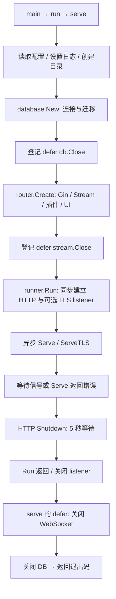

# Gotify 源码带读：HTTP 退出之后，谁来关闭 WebSocket？

状态：第一轮静态源码分析；未构建运行、未执行退出实验。核验日期：2026-10-30。

基线：**v3.1.1**，完整 SHA `e6361caa512547052b1013dbf4544e6d7ff32604`。范围是常规 serve、HTTP/TLS、消息流与数据库清理；插件内部及部署进程链未全面审计。[证据清单](gotify.sources.json)记录具体文件与符号。

## 1. 从入口把所有权画出来

Gotify 是消息推送服务。普通 HTTP 请求创建消息，WebSocket 将消息推送给在线客户端。这两种连接的生命周期不同，决定了它不能只依靠一次 HTTP Shutdown 收尾。



先沿 [serve][GF_SERVE] 读一遍，再进入 [runner.Run][GF_RUN]，最后回到 [router.Create][GF_ROUTER]。这样能分清三层职责：入口拥有数据库，Router 拥有消息流对象，Runner 管理 HTTP 监听与等待。

[main][GF_ENTRY] 写的是 `os.Exit(run(...))`。这里先求出 run 的返回值，serve 中的 defer 已经随返回执行；并不是一看到 os.Exit 就能认定这些清理都被跳过。另一方面，运行过程中直接调用 Fatal 退出属于另一条路径。

## 2. 监听之前，已经完成了什么？

[serve][GF_SERVE] 先读取配置并配置 zerolog，检查需要报告的配置错误，创建插件和上传目录，再调用 database.New。之后才创建路由并开始监听。

[database.New][GF_DB] 按配置打开 SQLite、MySQL 或 PostgreSQL 的 GORM 连接，设置连接池，执行 AutoMigrate；必要时创建默认管理员，并执行补齐历史字段的事务。这些都位于监听之前。数据库迁移是这一常规启动链的实际步骤，与 Answer 容器脚本调用独立 upgrade 的组织方式不同。

这里应看到两个清理边界：

- database.New 成功返回后，serve 才能登记 `defer db.Close()`。New 内部打开连接后，如果迁移或后续步骤出错，本函数没有统一的失败关闭 defer。因此外层清理不覆盖构造函数内部的全部失败。
- router.Create 成功返回后，serve 才登记它返回的关闭函数。该版本插件 Manager 创建失败时会 panic；此时 DB 的 defer 已登记，Router 返回值的 defer 尚未登记，已经启动的内部活动需要另查。[装配代码][GF_ROUTER]

这不是要求所有初始化都能回滚：数据库迁移的外部副作用也不会由 Close 撤销。要区分“释放连接”和“撤销数据变化”。

本版声明 Go 1.25.0、Gin v1.12.0、GORM v1.31.2、zerolog v1.35.1；WebSocket 使用 gorilla/websocket。[go.mod][GF_MOD] 这里记录依赖在主链中的职责，不展开框架通用教程。

## 3. Runner 把监听错误和运行错误交给谁？

[Run][GF_RUN] 先启动信号接收，再同步创建普通 listener；启用 SSL 时还同步创建 TLS listener。只有 listener 创建成功，才异步调用 Serve/ServeTLS。第二个 listener 创建失败时，第一个已登记的 defer 会关闭它。

与 Memos 相似，这里把“绑定端口失败”作为同步错误返回；与 Memos 不同，异步 Serve 返回后会调用 doShutdown，尝试通知主等待流程。

核心原码如下；省略了中间的监听构造：

```go
shutdown := make(chan error)
// ... Serve / ServeTLS 在其他 goroutine 中调用 doShutdown
err = <-shutdown
log.Info().Err(err).Msg("Shutting down")

ctx, cancel := context.WithTimeout(context.Background(), 5*time.Second)
defer cancel()
return s.Shutdown(ctx)
```

注意最后一行：**返回值是 Shutdown 的结果，触发退出的原始错误只被记录。** 因此不能简单写成“Serve 故障必然变成进程非零退出码”。若通知成功送达且 Shutdown 返回 nil，serve 可以返回 0。[调用位置][GF_SERVE]

另外，[doShutdown][GF_NOTIFY] 使用无缓冲 channel 与非阻塞发送：

```go
select {
case shutdown <- err:
default:
}
```

源码注释将“当前没有接收者”解释为已经开始退出。但静态上还有另一个窗口：主流程尚未走到接收语句时，早到的信号或 Serve 错误也可能被丢弃。这是需要通过时序实验确认影响的风险，不能把它描述为已经复现的故障。

[信号处理][GF_SIGNAL] 接收 Interrupt/SIGTERM；[监听函数][GF_LISTEN] 的 Listen 日志说明绑定成功，不代表所有业务依赖未来持续健康。

## 4. HTTP 与 WebSocket：两个需要分开收尾的对象

Go 官方说明：`http.Server.Shutdown` 关闭 listener、关闭空闲连接并等待活跃 HTTP 连接回到空闲状态；它不会关闭或等待被 hijack 的连接，例如 WebSocket。超时会返回错误，不能由此推导出所有 handler 已结束。[官方语义](https://pkg.go.dev/net/http#Server.Shutdown)

Gotify 的 [Stream.Handle][GF_WS] 升级连接后，将 client 登记到 Stream，分别启动读循环、写循环，然后 HTTP handler 返回。因此这些长连接需要 Stream 自己管理。

[router.Create][GF_ROUTER] 最终返回的关闭函数就是 `streamHandler.Close`。serve 中 defer 的后进先出顺序使正常返回时先关闭 Stream，再关闭 DB。值得保留的读法是：看到返回的 `func()`，一定追到它究竟关了什么，而不是从“Router cleanup”这个概念推断它关闭了全部组件。

[Stream.Close][GF_WSCLOSE] 遍历当前 client，调用各自 Close，再清空登记表。[client.Close][GF_CLIENT] 关闭底层 WebSocket 和 closed 通知；[读循环][GF_READER] 因连接关闭而返回，[写循环][GF_WRITER] 有接收 closed 的分支，并在返回时停止 ping ticker。

但这条链的保证也有范围：

1. Stream.Close 没有等待两个循环都返回的完成屏障。关闭连接、发出通知，与等待执行结束，是不同的事。
2. Close 的注释说停止回答新连接，但当前实现没有 closed 状态或 register 拒绝逻辑。停止新连接主要依赖前面的 HTTP 停止；尤其在 HTTP 等待超时的情形下，不能仅凭这句注释证明不再登记新 client。
3. HTTP Shutdown 超时后 Runner 没有在该分支继续调用 `s.Close()`。入口仍会走 Stream/DB 的 defer；不能证明所有普通 handler 都先于 DB 关闭完成。

## 5. 消息已写入，不等于客户端已经收到

[CreateMessage][GF_MESSAGE] 先调用 DB.CreateMessage，成功后调用 Notifier.Notify，最后返回 JSON。Stream.Notify 将消息交给客户端写通道；真正的网络写发生在另一个循环。

由此能明确三件不同的事：消息存储成功、进入在线推送路径、客户端实际接收。当前退出链关闭连接，并没有等待所有已排队消息获得客户端确认的流程。它提供的不是“退出前所有在线消息已送达”的证明。

这也是业务塑造生命周期的例子：消息服务需要先定义自己承诺的是持久化、可查询，还是还包含在线送达。只有承诺明确，才能判断退出时需要排空哪些队列、等待哪一种确认。这里是从调用顺序得出的设计分析，没有实测交付语义或恢复效果。

## 6. 返回的 cleanup 没有覆盖全部后台活动

[router.Create][GF_TICKER] 启动一个五分钟 ticker，定期更新在线客户端 token 的使用时间与过期时间，并清理过期客户端。该循环持有数据库与 Stream，代码中没有接收停止通知的分支，也没有接入返回的关闭函数。

所以“WebSocket 被关闭，随后 DB 被关闭”并不构成“所有数据库使用者都已停止”的完整证明。进程最终退出会结束剩余 goroutine，但它与服务主动等待收尾不是同一层保证。若将这段组织方式移植到可重复启动、长期运行的测试或嵌入场景，这个区别尤其需要考虑。

插件在装配中被创建，但返回的单一 Stream.Close 没有表达插件的整体停止协议。本篇不据此声称所有插件一定泄漏，也不将它们算作已经审计完成的清理对象。

## 7. 健康响应和退出预算分别意味着什么？

[HealthAPI.Health][GF_HEALTH] 会调用 DB.Ping；失败返回 500，成功返回 200。[Ping 实现][GF_PING] 将检查交给底层数据库连接。这比固定返回 200 多了一层实时依赖检查，但仍没有显式 draining 标志，也不检查插件、消息推送消费能力等状态。

五秒是 Runner 传给 HTTP Shutdown 的等待期限。Stream.Close、数据库 Close，以及尚未接入停止的后台活动，没有共同接受这个期限；所以它不是整个进程退出的硬上限。[HTTP 等待][GF_RUN]、[DB 关闭][GF_DBCLOSE]

本版还有运行中 Fatal 的路径，例如启用非自动证书 TLS 却没有配置证书文件时。不能把正常 return 的清理图推广为所有失败路径；SIGKILL、崩溃等也要回到 [通用模型](../foundations.md) 讨论恢复承诺。


[GF_ENTRY]: https://github.com/gotify/server/blob/e6361caa512547052b1013dbf4544e6d7ff32604/app.go#L35-L37
[GF_SERVE]: https://github.com/gotify/server/blob/e6361caa512547052b1013dbf4544e6d7ff32604/app.go#L82-L124
[GF_DB]: https://github.com/gotify/server/blob/e6361caa512547052b1013dbf4544e6d7ff32604/database/database.go#L33-L113
[GF_DBCLOSE]: https://github.com/gotify/server/blob/e6361caa512547052b1013dbf4544e6d7ff32604/database/database.go#L179-L185
[GF_ROUTER]: https://github.com/gotify/server/blob/e6361caa512547052b1013dbf4544e6d7ff32604/router/router.go#L28-L262
[GF_TICKER]: https://github.com/gotify/server/blob/e6361caa512547052b1013dbf4544e6d7ff32604/router/router.go#L72-L87
[GF_RUN]: https://github.com/gotify/server/blob/e6361caa512547052b1013dbf4544e6d7ff32604/runner/runner.go#L21-L61
[GF_SIGNAL]: https://github.com/gotify/server/blob/e6361caa512547052b1013dbf4544e6d7ff32604/runner/runner.go#L63-L68
[GF_NOTIFY]: https://github.com/gotify/server/blob/e6361caa512547052b1013dbf4544e6d7ff32604/runner/runner.go#L70-L77
[GF_LISTEN]: https://github.com/gotify/server/blob/e6361caa512547052b1013dbf4544e6d7ff32604/runner/runner.go#L79-L95
[GF_WS]: https://github.com/gotify/server/blob/e6361caa512547052b1013dbf4544e6d7ff32604/api/stream/stream.go#L145-L160
[GF_WSCLOSE]: https://github.com/gotify/server/blob/e6361caa512547052b1013dbf4544e6d7ff32604/api/stream/stream.go#L163-L175
[GF_CLIENT]: https://github.com/gotify/server/blob/e6361caa512547052b1013dbf4544e6d7ff32604/api/stream/client.go#L45-L50
[GF_READER]: https://github.com/gotify/server/blob/e6361caa512547052b1013dbf4544e6d7ff32604/api/stream/client.go#L63-L77
[GF_WRITER]: https://github.com/gotify/server/blob/e6361caa512547052b1013dbf4544e6d7ff32604/api/stream/client.go#L83-L108
[GF_MESSAGE]: https://github.com/gotify/server/blob/e6361caa512547052b1013dbf4544e6d7ff32604/api/message.go#L363-L401
[GF_HEALTH]: https://github.com/gotify/server/blob/e6361caa512547052b1013dbf4544e6d7ff32604/api/health.go#L34-L46
[GF_PING]: https://github.com/gotify/server/blob/e6361caa512547052b1013dbf4544e6d7ff32604/database/ping.go#L4-L10
[GF_MOD]: https://github.com/gotify/server/blob/e6361caa512547052b1013dbf4544e6d7ff32604/go.mod#L1-L86
