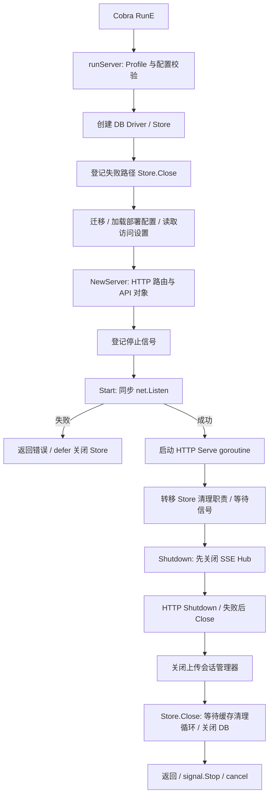

# Memos 源码带读：监听握手、资源所有权与分阶段退出

状态：第一轮静态源码分析；未编译运行、未执行退出实验。核验日期：2026-10-30。

基线：Memos **v0.31.0**，完整 SHA `2b2192d4e153bd04f1d325b60fd880cf00d68b01`。本轮选择官方 release 标签，不混入主分支后续代码。资料入口为 [通用模型](../foundations.md)，对照 [Answer 带读](answer.md)；全部引用与核验范围见 [证据清单](memos.sources.json)。

## 1. 先看完整链路



这里使用显式函数装配与 Server 方法，没有通过 Answer 使用的 Wire/Pacman 来组织这一主链。两份项目都要完成生命周期职责，职责放置的位置不同。

## 2. 入口与配置：先把失败变成可返回的错误

[main][M_MAIN] 调用 Cobra；命令的 RunE 返回 `runServer()` 的错误。main 在错误返回后记录日志、执行 `os.Exit(1)`。runServer 内已登记的 defer 会先随函数返回执行；不能把 main 后面的 os.Exit 误解成会执行仍未展开的全部 defer。

[runServer][M_RUN] 构造 Profile，处理 webhook 相关设置，调用 Profile.Validate，随后创建 context、数据库 Driver 和 Store。Viper 在 [init][M_CONFIG] 中绑定 flags 与 MEMOS 前缀的环境变量；完整配置优先级留到配置专题，本篇只追踪生命周期位置。

本轮读取的 go.mod 声明 Go 1.27.0，依赖 Echo v5.3.1、Cobra v1.10.2、Connect v1.20.0、grpc-gateway v2.30.0。[依赖基线][M_MOD] 这只是源码声明，不等于已核验某个现成二进制的工具链。

## 3. Store 的清理所有权会发生转移

runServer 创建 Store 后，立即登记一个由 `closeStore` 控制的 defer。主要逻辑可以用下面的概念伪代码表示；这不是可直接编译的原始摘录：

```text
创建 Store
closeStore = true
登记 defer：若 closeStore 为 true，关闭 Store

执行迁移与配置加载
构造 Server
启动 Server
若启动成功：closeStore = false

等待信号
调用 Server.Shutdown，由它关闭 Store
```

好处是清理责任明确：启动尚未成功时，runServer 负责；服务成功启动后，Server.Shutdown 负责。避免两个所有者都认为“对方会处理”，也避免正常路径上重复关闭同一 Store。[具体实现][M_RUN]

需要同时看到边界：保护发生在 Store 成功创建之后，并不自动覆盖 Driver 构造函数内部的一切失败；它也不是撤销外部副作用的事务。迁移已经执行的内容，不会因为 Store.Close 而自动回滚。

这里还不能写成“整个构造图的所有资源已覆盖”：NewServer 中其他组件的部分失败也需要逐项核对。本轮确认的是 Store 的责任转移。

## 4. 迁移是正式启动步骤，数据库构造与可用性检查分开看

runServer 在监听之前执行 Store.Migrate、LoadDeploymentConfiguration，并读取实例访问设置。相应错误直接沿 RunE 返回；已登记的 Store 清理会执行。[启动顺序][M_RUN]、[迁移入口][M_MIGRATE]

这与 Answer 需要区分：Answer 的容器脚本调用独立 upgrade 命令；本版 Memos 的常规 runServer 链本身调用 Migrate。两者的部署约束和迁移安全性仍要另行研究，不能只凭组织位置判断哪个更好。

以默认 SQLite 路径为例，[NewDB][M_SQLITE] 使用 sql.Open 构造 Driver，本函数没有另行 Ping；随后迁移会实际访问数据库。不能照搬 Answer 的“NewDB 中明确 Ping”这一结论。不同数据库后端应分别核验，本篇不把 SQLite 的构造行为泛化到所有 Driver。

## 5. NewServer 建立处理能力，Start 建立监听

[NewServer][M_NEW] 创建 Echo、中间件和实例 secret，注册健康检查、前端、文件服务、API 和 MCP 路由。它建立请求处理对象，尚未开启网络监听。API 对象持有 SSEHub 和上传会话管理器。[API 构造][M_API]

[Start][M_START] 先同步调用 `net.Listen`，支持 TCP 或 Unix socket；监听失败直接返回。Unix socket 权限设置失败时，它还显式关闭已经建立的 listener。只有完成这些步骤，才创建 http.Server 并在 goroutine 中 Serve。

于是返回成功提供了一个明确但有限的保证：**监听已经建立。** 它不等于未来不会遇到 Serve 错误，也不保证所有业务依赖持续健康。

与 Answer 对照时，应区分两个时刻：Answer 由 Pacman 在 goroutine 里调用 ListenAndServe，并将返回错误送到协调 channel；Memos 直接让 Start 同步返回监听错误，但 Serve 后续错误只记录日志。Memos 主流程在启动成功后主要等待 signals，并没有在这段等待里同时接收 Serve 的错误。

因此，一个入口能够很好地报告“端口被占用”，不意味着它也以同样方式处理“开始服务以后异常退出”。这是本轮静态检出的差异，尚未通过故障注入验证。

## 6. 就绪判断：响应文字不是全部语义

`/healthz` 返回固定的 HTTP 200 和 `Service ready.`，处理器中没有数据库检查或排空标记。[定义][M_HEALTH]

其可用性有启动顺序的支撑：迁移、配置加载、路由构造、监听建立都发生在它开始被服务之前。但运行时依赖故障、排空期间的状态变化，是另一组需要说明的语义，不能从这句响应文字推导出来。

上游启动测试会轮询 healthz 后再开展 API 断言。[bootInstance 与 waitUntilReady][M_TEST] 测试作者选择了这个可观察入口，不等于我们已经执行测试或证明所有依赖随时可用。

## 7. 停止触发：context 存在，不代表它在退出开始时取消所有工作

runServer 在构造 Server 之后、Start 之前登记 os.Interrupt 与 SIGTERM，退出时调用 signal.Stop。服务成功启动后，它阻塞等待 signals，收到后执行 `s.Shutdown(context.Background())`。[主链][M_RUN]

runServer 开头创建的 cancel 通过 defer 登记，发生在 Shutdown 返回、runServer 展开时。它不是在收到信号的瞬间立即广播给所有组件的统一取消动作。

这也解释为什么“持有根 context”与“统一管理全部后台工作”不是一回事：需要查看各任务是否派生该 context、何时取消，以及谁等待它们结束。本轮重点追踪已接入退出的 SSE、上传管理和缓存循环，不声称整个仓库所有异步活动都已审计。

## 8. 关闭 SSE：先让长期存在的请求有机会结束

Shutdown 先调用 SSEHub.Close，再执行 HTTP 关闭。[主关闭流程][M_STOP]

[SSEHub.Close][M_HUB] 将 hub 标为 closed，关闭各客户端的 done 与 events；之后新订阅得到的是关闭状态。[SSE handler][M_SSE] 在循环中监听 done、请求 context 和事件 channel，收到断开通知后返回。

这里可以完整看到“发通知”和“谁响应”：Hub 发出结束信号，处理器在运行循环里响应；后续 HTTP Shutdown 负责等待请求层面的收尾。Hub.Close 本身并没有逐个等待所有 handler 退出。

它的业务背景也很清楚：SSE 请求可能持续存活，不能期待它像普通短请求那样很快自然结束。把长连接策略放在通用 HTTP 排空之前，是一个值得比较的具体次序。

仍有边界：如果处理器卡在网络写入或其他不及时响应的操作中，关闭 channel 不会自动中断那条语句；还需要后续 HTTP 超时与连接关闭策略。这里没有实测所有慢客户端场景。

## 9. 十秒 HTTP 等待、强制关闭与整个进程预算

Server.Shutdown 从传入 context 派生十秒 context，然后按顺序处理 SSE、HTTP、上传、Store。[主流程][M_STOP]

HTTP 的实现先调用标准库 Shutdown；返回错误时记录日志，再调用 http.Server.Close。这一点与前一份样本的 Pacman HTTP 包不同：它增加了关闭连接的兜底动作。

但需要把保证说准确：

- Close 不等于业务处理器已经按业务语义完成，也不等于撤销事务或外部副作用。
- 这个 context 被传给 HTTP 关闭，CloseUploads 和 Store.Close 没有接受同一个 context。
- 因此十秒是 HTTP 阶段的重要上界参数，不能称为整个进程的严格退出上限。
- Shutdown 没有返回 error；内部异常主要记录日志，最后仍有 stopped properly 的日志。单独看到该日志，不足以判断每个阶段都成功收尾。

这些是对当前源码控制流的观察，不是退出耗时或数据影响的测量结果。

## 10. 上传会话与缓存：把通知接到完成条件上

### 上传会话

[CloseUploads][M_UPLOAD] 关闭附件上传与 memo 导入管理器。管理器标记 closed，停止过期清扫循环，等待 done，然后处理临时文件与记录。create/get 会检查 closed，防止关闭后继续按正常方式使用会话。

这展示了“停止接收 → 通知后台循环 → 等待完成 → 清理资源”的局部协议。实现中还会等待会话锁、访问文件系统，因此不能仅因 HTTP context 已到期就认为这一段也必然立即结束。

上传状态注明为进程私有、依赖临时文件；过期清扫中有孤立文件处理线索，但本轮没有验证进程崩溃后的恢复或跨重启续传保证。

### Store 缓存

Store.New 创建三个缓存，每个缓存启动清扫 goroutine。Store.Close 先依次调用这些缓存的 Close，再关闭数据库 Driver。[Store][M_STORE]、[缓存构造][M_CACHE_NEW]

[缓存 Close][M_CACHE] 关闭 stopChan，并等待 closedChan；cleanupLoop 退出时停止 ticker，再关闭完成 channel。这里既有停止请求，也有可以等待的完成条件，且它确实接入了 Store 的主清理路径。

这与 Answer 中“缓存有定期保存循环，但最终保存函数没有停止并等待该循环”的关系不同。两者缓存职责也不同，不能只以是否使用 channel 对整体设计打分。

## 11. 四条路径与证据边界

| 路径 | 当前代码提供的组织 | 仍要验证什么 |
| --- | --- | --- |
| 正常启动 | Profile 校验 → Driver/Store → 迁移与配置 → 路由 → 同步监听 | 真正的可用条件，依赖故障下的行为 |
| 启动失败 | Store 创建后立即登记失败清理；监听/Unix 权限失败返回 | Driver/Server 构造内部其他局部资源，迁移副作用 |
| 正常退出 | 信号 → SSE 通知 → HTTP 等待/关闭 → 上传管理 → Store | 慢请求、锁等待、整个流程耗时，失败结果如何报告 |
| 异常终止 | 看到持久化与临时状态管理的部分线索 | 没有清理机会时的数据承诺、恢复与重复执行 |

## 12. 测试能告诉我们什么

本轮读到了上游 [启动集成测试][M_TEST]、[重启后保留数据测试][M_RESTART_TEST]、[SSE Hub 关闭测试][M_HUB_TEST] 的代码。

这些测试显式调用 Server.Start/Shutdown，没有覆盖真实进程信号与强制终止；重启数据测试也没有模拟突然掉电。

容器 [Dockerfile][M_DOCKER] 通过入口脚本启动；[entrypoint.sh][M_ENTRY] 最后使用 exec 执行传入命令。能确认的是脚本文本采用显式进程替换，不能代替容器 PID、信号与权限的实际验证。


[M_RUN]: https://github.com/usememos/memos/blob/2b2192d4e153bd04f1d325b60fd880cf00d68b01/cmd/memos/main.go#L110-L201
[M_MAIN]: https://github.com/usememos/memos/blob/2b2192d4e153bd04f1d325b60fd880cf00d68b01/cmd/memos/main.go#L228-L233
[M_CONFIG]: https://github.com/usememos/memos/blob/2b2192d4e153bd04f1d325b60fd880cf00d68b01/cmd/memos/main.go#L51-L113
[M_NEW]: https://github.com/usememos/memos/blob/2b2192d4e153bd04f1d325b60fd880cf00d68b01/server/server.go#L49-L119
[M_START]: https://github.com/usememos/memos/blob/2b2192d4e153bd04f1d325b60fd880cf00d68b01/server/server.go#L108-L150
[M_STOP]: https://github.com/usememos/memos/blob/2b2192d4e153bd04f1d325b60fd880cf00d68b01/server/server.go#L144-L192
[M_HEALTH]: https://github.com/usememos/memos/blob/2b2192d4e153bd04f1d325b60fd880cf00d68b01/server/server.go#L79-L83
[M_STORE]: https://github.com/usememos/memos/blob/2b2192d4e153bd04f1d325b60fd880cf00d68b01/store/store.go#L82-L89
[M_CACHE]: https://github.com/usememos/memos/blob/2b2192d4e153bd04f1d325b60fd880cf00d68b01/store/cache/cache.go#L187-L216
[M_CACHE_NEW]: https://github.com/usememos/memos/blob/2b2192d4e153bd04f1d325b60fd880cf00d68b01/store/cache/cache.go#L76-L88
[M_HUB]: https://github.com/usememos/memos/blob/2b2192d4e153bd04f1d325b60fd880cf00d68b01/server/api/v1/sse_hub.go#L63-L79
[M_SSE]: https://github.com/usememos/memos/blob/2b2192d4e153bd04f1d325b60fd880cf00d68b01/server/api/v1/sse_handler.go#L88-L131
[M_UPLOAD]: https://github.com/usememos/memos/blob/2b2192d4e153bd04f1d325b60fd880cf00d68b01/server/api/v1/upload_session.go#L233-L264
[M_MIGRATE]: https://github.com/usememos/memos/blob/2b2192d4e153bd04f1d325b60fd880cf00d68b01/store/migrator.go#L102-L149
[M_SQLITE]: https://github.com/usememos/memos/blob/2b2192d4e153bd04f1d325b60fd880cf00d68b01/store/db/sqlite/sqlite.go#L24-L77
[M_API]: https://github.com/usememos/memos/blob/2b2192d4e153bd04f1d325b60fd880cf00d68b01/server/api/v1/v1.go#L97-L123
[M_TEST]: https://github.com/usememos/memos/blob/2b2192d4e153bd04f1d325b60fd880cf00d68b01/server/test/startup_test.go#L70-L146
[M_RESTART_TEST]: https://github.com/usememos/memos/blob/2b2192d4e153bd04f1d325b60fd880cf00d68b01/server/test/startup_test.go#L325-L357
[M_HUB_TEST]: https://github.com/usememos/memos/blob/2b2192d4e153bd04f1d325b60fd880cf00d68b01/server/api/v1/sse_hub_test.go#L49-L89
[M_ENTRY]: https://github.com/usememos/memos/blob/2b2192d4e153bd04f1d325b60fd880cf00d68b01/scripts/entrypoint.sh#L50-L52
[M_DOCKER]: https://github.com/usememos/memos/blob/2b2192d4e153bd04f1d325b60fd880cf00d68b01/scripts/Dockerfile#L56-L56
[M_MOD]: https://github.com/usememos/memos/blob/2b2192d4e153bd04f1d325b60fd880cf00d68b01/go.mod#L1-L86
