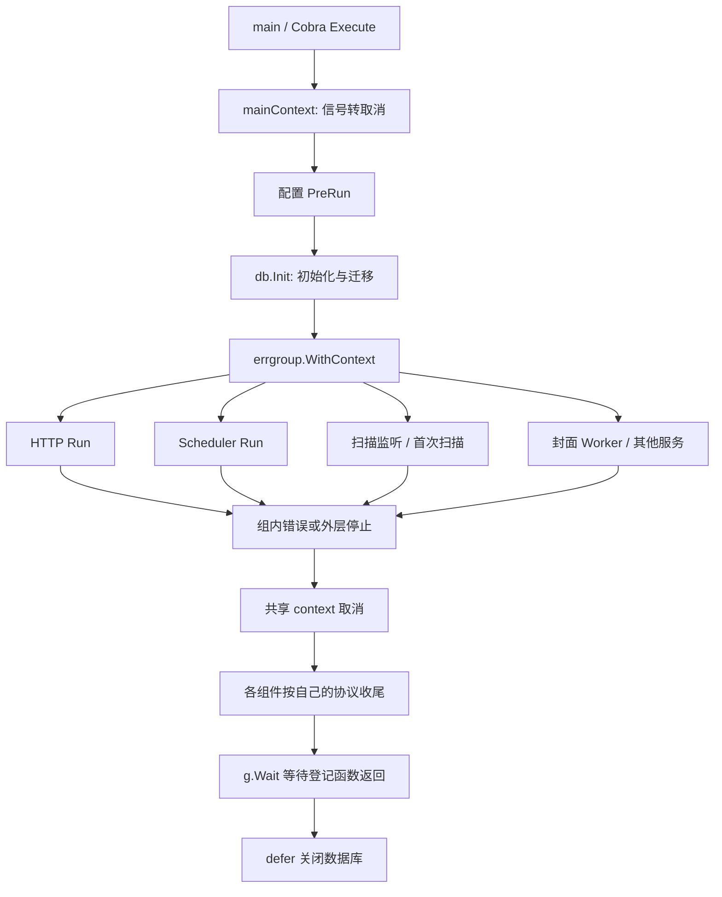

# Navidrome 带读：服务与后台任务如何一起启动、退出

状态：第一轮静态源码分析；未构建、未运行服务或测试。核验日期：2026-10-30。

基线：**v0.64.2**，完整提交 `101145742f4762164202cb4858c9126258bdc463`。本轮核对官方发布标签，以固定版本阅读常规命令、HTTP、扫描、调度和封面工作器；服务管理命令作为补充路径。不覆盖所有插件、转码子进程及全部存储实现。引用与依赖见 [证据清单](navidrome.sources.json)。

先读 [通用模型](../foundations.md)，再与 [Answer](answer.md)、[Memos](memos.md) 比较。本文最重要的问题是：当一个组件返回时，它启动的工作是否也已经结束？

## 1. 总体结构：先准备数据库，再监督多个运行函数



这个图表达协调关系，不能据此认定底层所有 goroutine 都纳入了 g.Wait。各组件的“返回契约”仍要分别检查。

## 2. 入口：生命周期从命令 context 开始

[main][N_ENTRY] 调用 cmd.Execute。Execute 创建 mainContext，将它交给 Cobra ExecuteContext；配置由命令的初始化和 PreRun 加载，再进入 runNavidrome。

[mainContext][N_SIGNAL] 使用 signal.NotifyContext 接收 os.Interrupt、SIGHUP、SIGTERM、SIGABRT。对这个版本的普通入口，SIGHUP 被用来触发取消，不能凭 Unix 使用习惯把它描述成热加载配置。

Unix 的 [startSignaller][N_UNIX] 另接收 SIGUSR1 触发扫描；[Windows/Plan9 版本][N_NONUNIX] 返回空工作函数。信号含义与构建平台相关，不应把 SIGUSR1 当成跨平台扫描入口。

## 3. defer db.Init(ctx)()：初始化现在执行，关闭稍后执行

[runNavidrome][N_RUN] 开头有一句值得停下来理解的代码：

```go
defer db.Init(ctx)()
```

它先调用 db.Init(ctx)，拿到返回的关闭函数，再把这个函数的执行登记为 defer。不是“等服务结束才初始化数据库”。

[db.Init][N_DB] 创建数据库访问、设置迁移环境，调用 goose 迁移，再返回调用 Close 的函数。数据库清理在 runNavidrome 返回时发生，位置在 g.Wait 之后。

[db.Close][N_DB_CLOSE] 使用 context.WithoutCancel 保留其他上下文信息而不继承取消，再调用数据库 Close。这样收尾不因运行 context 已取消而自动跳过；同时它没有获得一个新的收尾 deadline。不能把“忽略取消”解释成无条件安全或有界等待。

还要检查早期失败：[log.Fatal][N_FATAL] 实际执行 os.Exit(1)。db.Init 内部分支使用它，意味着初始化尚未返回关闭函数就可能直接结束进程。不能用这一条 defer 宣称所有初始化失败都沿统一清理链退出。

## 4. 多个服务如何协同停止

runNavidrome 将 HTTP、调度、扫描监听、封面工作器等运行函数交给 errgroup，并在最后调用 g.Wait。[主流程][N_RUN]

对这条生命周期链，需要知道三件事：登记函数返回非 nil 错误会触发共享取消；Wait 等待登记函数返回；函数内部另起的工作需要由该组件自己等待。[锁定依赖][E_GROUP] 后面的 Cron、Watcher 和 Worker 分析分别核对这种等待是否接上。

g.Wait 的错误在 runNavidrome 中被记录后，函数直接返回，没有继续作为 error 交给 Cobra；日志中的“Fatal error”也不是对 log.Fatal 的调用。

## 5. HTTP：同步监听、持续错误回传与三秒排空

[Server.Run][N_HTTP] 验证 TLS 参数、创建 TCP 或 Unix listener，然后 goroutine 执行 Serve/ServeTLS。非 ErrServerClosed 错误进入 errC。

Run 先短暂观察 50ms 错误窗口，打印 ready 日志，随后继续 select：HTTP 错误或 ctx.Done。与 Memos 的后台 Serve 仅记日志相比，这里后续 Serve 错误能够作为 Run 的返回值进入外层 errgroup。

但 50ms 没有错误只是一个启动观察窗口，不是完整业务就绪证明。初始扫描同时在组内进行，并不保证打印 ready 时音乐库已经扫描完成。两秒首次扫描延迟也不是“等待 HTTP 真正就绪”的握手机制。[首次扫描][N_INITIAL_SCAN]

ctx 取消的正常收尾分支会：

1. 创建独立的三秒 shutdown context。
2. 禁用 keep-alive。
3. 调用 http.Server.Shutdown。
4. 非 DeadlineExceeded 的关闭错误写日志，然后返回 nil。

在这个分支没有看到超时后调用 Server.Close 的兜底；也没有把 DeadlineExceeded 继续返回给 group。这与 Memos 的处理不同。三秒不是整个服务退出的上限，g.Wait 还要等待其他登记函数。

运行错误与取消分支也不是完全相同的路径：在 errC 分支，Run 直接返回错误，不能把后面的 Shutdown 代码说成所有错误分支必然执行的公共 defer。

路由中有 middleware.Heartbeat("/ping")。[路由配置][N_HEALTH] 本篇未深入这个依赖实现或实际部署的探针配置，不据此声称持续检测了数据库与扫描能力。

## 6. Cron：停止继续调度，不等于已执行任务结束

[scheduler.Run][N_SCHED] 很短：Start，等待 ctx.Done，调用 Stop，然后返回。

这里使用 robfig/cron v3.0.1。[Cron.Stop 的锁定实现][C_STOP] 返回一个 context，调用方可以等它完成来确认运行中的 jobs 已返回。但 Navidrome 这段代码没有等待返回的 context。

因此需要区分：

| 事件 | 当前代码能证明什么 |
| --- | --- |
| scheduler.Run 结束 | 已发起停止调度的动作 |
| errgroup 中调度器函数结束 | 外层已经等到了这一个函数返回 |
| 所有 Cron jobs 已结束 | 不能仅由前两项证明；仍需等待 job 完成或另有接线 |

PeriodicScan 的闭包调用 ScanAll，错误被记录；注册任务本身失败时，也仅记录后返回 nil。[周期扫描][N_SCAN_JOB] 相比之下，备份注册返回 Add 的 error，能进入 group；备份执行中的错误则记录在 job 内。[备份安排][N_BACKUP]

这说明错误传播是调用方的明确选择：使用同一个 group，不代表所有业务失败都会取消整个应用。

## 7. Watcher：派生取消有了，等待还要另找

[Watcher.Run][N_WATCH] 为现有音乐库建立监听，根据文件变化去抖后，在普通 goroutine 中执行扫描。收到取消时，它遍历 watcher 实例调用 cancel，再返回。

这个函数及其 Watch 路径里没有将这些库 watcher、临时触发的扫描逐个登记到外层 group，也未在 Run 的取消返回前统一等待其完成。它们可以共享取消意图，但“取消传到”和“已经结束”仍是两件事。

[扫描控制器][N_CONTROLLER] 将扫描工作放在 goroutine 中，通过 progress channel 跟踪；trackProgress 使用 ReadOrDone，取消时进度读取可以结束。[进度读取][N_TRACK] 本轮没有完整证明生产端的扫描流水线一定已退出，不把取消读进度当成生产端完成信号。

扫描使用服务 rootCtx 为基础，通过 [request.AddValues][N_VALUES] 复制请求身份等值。它不是把请求的取消与 deadline 也全部复制过去。因此可以研究“用户发起的扫描是否应该随请求断开而结束”这一所有权问题，但不将该设计泛化到所有请求。

这些观察只限定于本轮读取的 watcher/controller 链，尚未审计每个存储监听器和所有扫描阶段，也未复现 goroutine 残留或数据库关闭冲突。

## 8. 封面 Worker：内部任务如何建立完成边界

[Worker.Run][N_WORKER] 按工作池启动 runPool，再用内部 WaitGroup 等待。runPool 接收相同 context，退出时停止 ticker。

[drain][N_DRAIN] 用 channel 控制并发，派发前检查取消，已派发任务进入自己的 WaitGroup；批次返回前等待任务。这提供了一个清楚的嵌套关系：外层 group 等 Worker.Run，Worker.Run 等池函数，池函数再等批次任务。

这是一条比“仅将 context 传下去”更可追踪的完成链。但它仍依赖 process、文件访问和外部调用及时返回；WaitGroup 本身没有时间上限，也不会强制终止不合作的任务。外部 agent、FFmpeg 等完整路径不在本轮审计范围内。

部分工作从数据库中的 ArtworkQueue 取得，也有失败重试与状态更新代码。本篇据此记录持久队列线索，不推导崩溃情况下的严格一次执行或完整恢复保证。

## 9. 启动、关闭与恢复的业务约束

[首次扫描][N_INITIAL_SCAN] 会查看上次扫描进行中标记、迁移要求和配置变化，以决定是否扫描。可以确认有识别中断扫描并重新处理的代码线索；它不是某次断电恢复成功的实验记录。

| 路径 | 当前静态认识 | 仍未证明的部分 |
| --- | --- | --- |
| 正常启动 | 配置和 DB 迁移后，多个服务并行运行 | 全部后台就绪是否形成统一屏障 |
| 启动失败 | 部分错误进入 group 取消其他登记函数；DB 初始化有 Fatal 直接退出路径 | 全部局部资源的失败清理覆盖 |
| 正常退出 | 信号取消 → 组件收尾 → g.Wait → DB Close | Cron job、派生扫描与所有子工作的全覆盖等待 |
| 异常终止 | 中断扫描标记、持久封面任务等恢复线索 | 崩溃时数据承诺、幂等性、重试结果 |

所以“数据库在 g.Wait 后关闭”是明确的外层顺序，但是否已经晚于所有真实使用者，取决于组件是否把子工作也纳入完成契约。

## 10. 服务管理模式还有一层预算

[svcControl][N_SVC] 的 Start 派生自己的取消 context，在 goroutine 中运行 runNavidrome，并在结束时关闭 done。Stop 发出取消，再等待 done 或十秒超时。

超时分支打印“Service did not stop in time. Killing it.”，但这个函数本身没有直接执行 kill；它随后返回。不能把日志句子当成已执行的系统动作。该仓库的 [systemd 模板][N_TEMPLATE] 还声明 TimeoutStopSec=20，这是另一层管理预算；实际部署采用何种配置仍需验证。

普通命令路径和服务管理模式应分开讲。本轮没有执行服务安装、修改系统服务，也没有验证真实信号和平台回调。


[N_ENTRY]: https://github.com/navidrome/navidrome/blob/101145742f4762164202cb4858c9126258bdc463/main.go#L11-L20
[N_RUN]: https://github.com/navidrome/navidrome/blob/101145742f4762164202cb4858c9126258bdc463/cmd/root.go#L81-L117
[N_SIGNAL]: https://github.com/navidrome/navidrome/blob/101145742f4762164202cb4858c9126258bdc463/cmd/root.go#L111-L120
[N_INITIAL_SCAN]: https://github.com/navidrome/navidrome/blob/101145742f4762164202cb4858c9126258bdc463/cmd/root.go#L199-L249
[N_SCAN_JOB]: https://github.com/navidrome/navidrome/blob/101145742f4762164202cb4858c9126258bdc463/cmd/root.go#L161-L186
[N_BACKUP]: https://github.com/navidrome/navidrome/blob/101145742f4762164202cb4858c9126258bdc463/cmd/root.go#L260-L303
[N_HTTP]: https://github.com/navidrome/navidrome/blob/101145742f4762164202cb4858c9126258bdc463/server/server.go#L59-L157
[N_HEALTH]: https://github.com/navidrome/navidrome/blob/101145742f4762164202cb4858c9126258bdc463/server/server.go#L166-L207
[N_SCHED]: https://github.com/navidrome/navidrome/blob/101145742f4762164202cb4858c9126258bdc463/scheduler/scheduler.go#L29-L36
[N_DB]: https://github.com/navidrome/navidrome/blob/101145742f4762164202cb4858c9126258bdc463/db/db.go#L81-L130
[N_DB_CLOSE]: https://github.com/navidrome/navidrome/blob/101145742f4762164202cb4858c9126258bdc463/db/db.go#L70-L82
[N_FATAL]: https://github.com/navidrome/navidrome/blob/101145742f4762164202cb4858c9126258bdc463/log/log.go#L208-L212
[N_WORKER]: https://github.com/navidrome/navidrome/blob/101145742f4762164202cb4858c9126258bdc463/core/artwork/worker.go#L101-L140
[N_DRAIN]: https://github.com/navidrome/navidrome/blob/101145742f4762164202cb4858c9126258bdc463/core/artwork/worker.go#L152-L218
[N_WATCH]: https://github.com/navidrome/navidrome/blob/101145742f4762164202cb4858c9126258bdc463/scanner/watcher.go#L58-L153
[N_CONTROLLER]: https://github.com/navidrome/navidrome/blob/101145742f4762164202cb4858c9126258bdc463/scanner/controller.go#L204-L282
[N_TRACK]: https://github.com/navidrome/navidrome/blob/101145742f4762164202cb4858c9126258bdc463/scanner/controller.go#L345-L396
[N_VALUES]: https://github.com/navidrome/navidrome/blob/101145742f4762164202cb4858c9126258bdc463/model/request/request.go#L143-L152
[N_SVC]: https://github.com/navidrome/navidrome/blob/101145742f4762164202cb4858c9126258bdc463/cmd/svc.go#L52-L78
[N_UNIX]: https://github.com/navidrome/navidrome/blob/101145742f4762164202cb4858c9126258bdc463/cmd/signaller_unix.go#L17-L40
[N_NONUNIX]: https://github.com/navidrome/navidrome/blob/101145742f4762164202cb4858c9126258bdc463/cmd/signaller_nounix.go#L10-L14
[E_GROUP]: https://github.com/golang/sync/blob/f75267d8412fc1dfd12b343644a7ea46e4d9c85d/errgroup/errgroup.go#L43-L112
[C_STOP]: https://github.com/robfig/cron/blob/ccba498c397bb90a9c84945bbb0f7af2d72b6309/cron.go#L323-L340
[N_TEMPLATE]: https://github.com/navidrome/navidrome/blob/101145742f4762164202cb4858c9126258bdc463/cmd/svc.go#L247-L250
