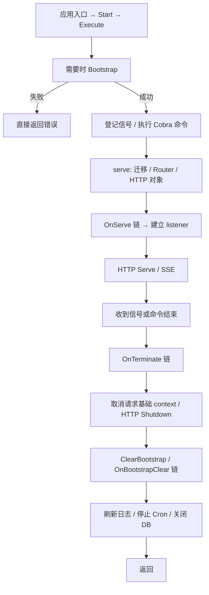

# PocketBase 源码带读：事件钩子怎样组织启动与清理？

状态：第一轮静态源码分析；未构建运行、未执行退出实验。核验日期：2026-10-30。

本篇选择迁移前 GitHub 仓库中的 **v0.40.6**，完整 SHA `9d281ccaba65f2686eb7b0b614ccda72d1116a1b`，作为可核验的历史样本。项目已迁往[新托管地址](https://ganigeorgiev.com/pocketbase/pocketbase)，[旧仓库](https://github.com/pocketbase/pocketbase)已归档；归档不代表项目停止开发，本篇也不代表新仓库当前实现。全部代码引用固定在上述 SHA。[证据清单](pocketbase.sources.json)

## 1. 这是一个可扩展应用，生命周期本身也是扩展点

与只暴露一个 runServer 的应用相比，PocketBase 还允许使用者把它嵌入自己的 Go 程序，通过事件钩子添加行为。因此阅读重点是：默认流程怎样执行、扩展代码怎样插入、插入后谁负责让流程继续。

[基础应用示例][PB_MAIN] 创建 PocketBase 实例、注册插件与命令，最后调用 app.Start。[Start][PB_START] 添加 serve 等系统命令，再调用 Execute。它并不是直接在 Start 中监听 HTTP。



图中默认清理成立的前提是相应事件链继续执行。用户扩展可以改变顺序或截断流程，这一点需要始终带着读。

## 2. Bootstrap 准备底座，Serve 准备网络服务

[BaseApp.Bootstrap][PB_BOOT] 触发 OnBootstrap，在默认处理里先清除旧 Bootstrap 状态，再创建数据目录、初始化主数据库与辅助数据库、日志，执行系统迁移，加载集合缓存与设置。

[serve 命令][PB_CMD] 再进入 [apis.Serve][PB_SERVE]。它先调用 RunAllMigrations，然后创建 Router、CORS、管理界面路由和 http.Server。因此要区分：

- Bootstrap 建立应用底座，并执行系统迁移。
- Serve 开始时执行完整迁移入口，再组装网络服务。
- OnServe 的默认末端处理器构建 mux，使用扩展提供的 listener 或调用 net.Listen；绑定成功后才打印启动 banner 并进入 Serve/ServeTLS。[绑定位置][PB_BIND]

不能将“app 已 Bootstrapped”与“HTTP 已监听”合并成同一状态。它也不意味着开发者的外部依赖全部可用。

本版声明 Go 1.27、Cobra v1.10.2、dbx v1.12.0、modernc.org/sqlite v1.60.1。[依赖声明][PB_MOD] 网络服务使用标准库；生命周期事件链位于项目自己的 tools/hook 中。

## 3. 看懂 Next，才能看懂默认清理是否真的执行

[Hook.Bind][PB_HOOK] 按 Priority 从小到大稳定排序处理器；[Hook.Trigger][PB_CHAIN] 在已有处理器之后附加本次调用提供的默认末端处理器，再组装调用链。

每个处理器要调用 `e.Next()`，后面的链才继续。例如下面是解释执行关系的伪代码，不是可直接粘贴的 API 示例：

```text
自定义 OnServe 处理器：
    在默认启动前添加路由
    err = e.Next()       // 继续后续处理器，最终建立 listener
    若 err 不为空则返回
    在默认启动步骤后执行自己的逻辑
```

这不是本篇额外插入的通用 Hook 教程：不理解调用链，就会误判启动和清理的可靠性。默认 listener 构造、ClearBootstrap 都可能位于链的后部。

代码也显式处理了一种误用：[apis.Serve][PB_BIND] 在 OnServe 返回后检查 listener 是否仍为空，若为空就提示可能忘记调用 ServeEvent.Next。Bootstrap 则在返回成功但仍未初始化时记录警告。[Bootstrap 末尾][PB_BOOT]

相同约束也适用于退出：如果更早的 OnTerminate 处理器不调用 Next，或直接返回错误，后面的默认清理不一定执行。Priority 只是顺序控制，不能单独构成“无论扩展怎么写都一定释放资源”的保证。

## 4. Execute 等待什么？启动失败是否也会走退出钩子？

[Execute][PB_EXEC] 先执行必要的 Bootstrap。成功后创建带缓冲的命令结果 channel，登记 Interrupt/SIGTERM，再在 goroutine 中执行根命令；主流程同时等待信号或命令结果。

任一事件到来后，它停止信号登记，触发 OnTerminate。默认末端处理器调用 ClearBootstrap，并用 errors.Join 合并其错误与已接收到的命令错误。

这里有三个边界：

1. **Bootstrap 返回错误时，Execute 直接返回，尚未进入这段 OnTerminate 调用。** 不能把正常退出的钩子图当成初始化半途失败的完整回滚机制。
2. Serve 阶段的迁移、Router 或 listener 错误会通过命令结果回到 Execute，然后进入退出事件链；它与 Bootstrap 失败处在不同的位置。
3. 当信号分支先获选，Execute 并没有在退出前再次接收 execCh，等待整个命令 goroutine 返回。退出期间的主要等待来自钩子内部，不能将它描述为“Execute 最后统一 join 命令执行”。

[ClearBootstrap][PB_CLEAR] 在未 IsBootstrapped 时直接返回；而 Bootstrap 内部会分步创建连接。本篇没有证明所有局部构造失败都有完整释放路径。使用可嵌入框架时，尤其不能假设“调用 Start 出错后，全部部分资源都必然由 OnTerminate 关掉”。

## 5. 主 HTTP 的退出：先取消请求，再等待一秒

[apis.Serve][PB_SERVE] 为 http.Server 提供一个可取消的 BaseContext。HTTP 请求基于它运行；这用于取消 SSE 等长期请求，但影响范围不只 SSE。

它登记的 [pbGracefulShutdown][PB_STOP] 具有较早的 Priority -9999。正常链执行到这里时，依次做：

1. 调用 cancelBaseCtx，取消基于该 context 的请求。
2. 从独立 Background context 派生一秒期限，调用 server.Shutdown。
3. 忽略该调用返回的错误，完成本段等待标记，再继续 te.Next。
4. 后续链最终可以进入 ClearBootstrap，释放底座资源。

与 Gitea 对照，区别很具体：Gitea 的正常 Shutdown 阶段保留请求 context，到 Hammer 才取消；PocketBase 在 HTTP Shutdown 之前就取消基础请求 context。因此不能把两者都笼统称为“让所有在途请求不受打扰地完成”。取消只是通知，业务是否中断还取决于 handler 是否响应。

[SSE 的 realtimeConnect][PB_SSE] 明确监听 Request.Context().Done，收到取消后返回，并通过其清理路径移除客户端。这说明为什么先取消基础 context 有助于结束长连接。

标准库 Serve 在 Shutdown 启动后就可能返回，不代表 Shutdown 已完成。PocketBase 因此在 Serve 的 defer 中等待专门的 WaitGroup，再关闭 listener；源码注释也说明：如果根本没触发 OnTerminate，这个等待不会凭空执行 HTTP 清理。[等待的具体范围][PB_STOP] Restart 分支还安排额外延迟，本篇不验证进程替换行为。

一秒只约束 server.Shutdown。超时后没有在该回调里补 server.Close，且错误被忽略；如果某个 handler 无视 context，它仍可能与后面的资源清理重叠。也不能把这一个 WaitGroup 解释为等待全部应用 goroutine。

## 6. ClearBootstrap：先让使用者收尾，再释放数据库

[ClearBootstrap][PB_CLEAR] 触发 OnBootstrapClear，默认末端处理器依次关闭主库与辅助库的并发/非并发 builder，将引用清空，收集关闭错误。这里能直接看到哪些资源属于 BaseApp。

继续追两个默认钩子：

| 清理对象 | 接入方式 | 实际保证 |
| --- | --- | --- |
| 日志 | [OnBootstrapClear，Priority -999][PB_LOGSTOP] | 尝试写出排队日志，停止定时器并通知循环退出，然后 Next |
| Cron | [OnBootstrapClear，Priority 999][PB_CRONHOOK] | 调用 Cron.Stop，然后 Next |
| 数据库 | [事件链默认末端处理器][PB_CLEAR] | 尝试 Close 各 builder，清空引用并合并错误 |

不要只记下“日志 → Cron → DB”的顺序，还要核对每步是否等完。

[initLogger][PB_LOG] 里，普通批量写日志有异步分支；关闭钩子会根据是否处于辅助库事务中，决定本次 WriteAll 是否阻塞写入。它没有在这条链上统一等待之前全部异步日志写任务。因此“尝试刷新排队日志”比“保证所有日志已落盘”准确。

[Cron.Stop][PB_CRON] 停止启动定时器与 ticker；[runDue][PB_JOBS] 则把到期 job 交给 FireAndForget。Stop 没有登记和等待这些 job 完成，也没有向每个 job 传递统一取消 context。这使“停止后续调度”与“在途定时任务结束”存在实际差别。

因此数据库排在后面，只能证明这条同步清理链的调用顺序，不能证明所有后台数据库使用者都已经退出。若业务任务有必须完成的写入，扩展应用要另行表达它们的停止与完成协议。

## 7. 还有哪些范围不应被默认清理图掩盖？

[Serve 的 HTTPS 分支][PB_EXTRA] 可以额外启动一个用于 HTTP 重定向/证书挑战的 http.ListenAndServe；这里没有把它的 Server 实例接入上述主 Server 的关闭回调。因此主 HTTP 清理不自动等于全部 listener 都有同样的托管方式。

OnServe 还可能异步启动 installer，应用也能注册 JS 插件和任意自定义钩子。本篇确认的是默认底座和主 HTTP 的接线，并未审计所有插件、备份、文件清理或派生任务。

这里最有价值的经验是资源协议的可扩展性：框架提供启动前后与退出阶段的插入位置，应用可以添加自己的依赖和收尾动作；相应地，调用 Next、传播错误、安排等待以及保持依赖可用，就成为扩展代码必须遵守的契约。是否能沉淀为我们的脚手架，要结合其余样本和实际失败实验决定。


[PB_MAIN]: https://github.com/pocketbase/pocketbase/blob/9d281ccaba65f2686eb7b0b614ccda72d1116a1b/examples/base/main.go#L19-L126
[PB_START]: https://github.com/pocketbase/pocketbase/blob/9d281ccaba65f2686eb7b0b614ccda72d1116a1b/pocketbase.go#L167-L173
[PB_EXEC]: https://github.com/pocketbase/pocketbase/blob/9d281ccaba65f2686eb7b0b614ccda72d1116a1b/pocketbase.go#L180-L215
[PB_BOOT]: https://github.com/pocketbase/pocketbase/blob/9d281ccaba65f2686eb7b0b614ccda72d1116a1b/core/base.go#L412-L464
[PB_CLEAR]: https://github.com/pocketbase/pocketbase/blob/9d281ccaba65f2686eb7b0b614ccda72d1116a1b/core/base.go#L475-L515
[PB_CMD]: https://github.com/pocketbase/pocketbase/blob/9d281ccaba65f2686eb7b0b614ccda72d1116a1b/cmd/serve.go#L14-L77
[PB_SERVE]: https://github.com/pocketbase/pocketbase/blob/9d281ccaba65f2686eb7b0b614ccda72d1116a1b/apis/serve.go#L61-L314
[PB_STOP]: https://github.com/pocketbase/pocketbase/blob/9d281ccaba65f2686eb7b0b614ccda72d1116a1b/apis/serve.go#L172-L203
[PB_BIND]: https://github.com/pocketbase/pocketbase/blob/9d281ccaba65f2686eb7b0b614ccda72d1116a1b/apis/serve.go#L217-L281
[PB_EXTRA]: https://github.com/pocketbase/pocketbase/blob/9d281ccaba65f2686eb7b0b614ccda72d1116a1b/apis/serve.go#L299-L304
[PB_CRONHOOK]: https://github.com/pocketbase/pocketbase/blob/9d281ccaba65f2686eb7b0b614ccda72d1116a1b/core/base.go#L1434-L1451
[PB_LOG]: https://github.com/pocketbase/pocketbase/blob/9d281ccaba65f2686eb7b0b614ccda72d1116a1b/core/base.go#L1501-L1660
[PB_LOGSTOP]: https://github.com/pocketbase/pocketbase/blob/9d281ccaba65f2686eb7b0b614ccda72d1116a1b/core/base.go#L1591-L1613
[PB_CRON]: https://github.com/pocketbase/pocketbase/blob/9d281ccaba65f2686eb7b0b614ccda72d1116a1b/tools/cron/cron.go#L157-L173
[PB_JOBS]: https://github.com/pocketbase/pocketbase/blob/9d281ccaba65f2686eb7b0b614ccda72d1116a1b/tools/cron/cron.go#L219-L230
[PB_SSE]: https://github.com/pocketbase/pocketbase/blob/9d281ccaba65f2686eb7b0b614ccda72d1116a1b/apis/realtime.go#L43-L166
[PB_HOOK]: https://github.com/pocketbase/pocketbase/blob/9d281ccaba65f2686eb7b0b614ccda72d1116a1b/tools/hook/hook.go#L65-L104
[PB_CHAIN]: https://github.com/pocketbase/pocketbase/blob/9d281ccaba65f2686eb7b0b614ccda72d1116a1b/tools/hook/hook.go#L153-L174
[PB_MOD]: https://github.com/pocketbase/pocketbase/blob/9d281ccaba65f2686eb7b0b614ccda72d1116a1b/go.mod#L1-L50
